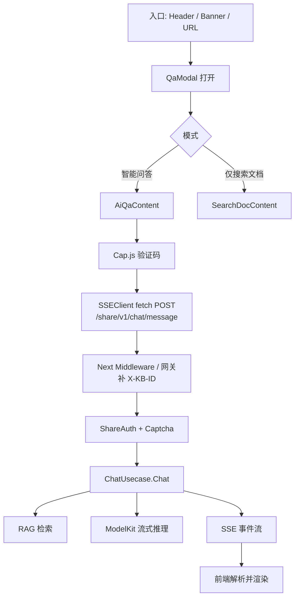
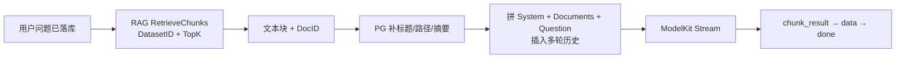
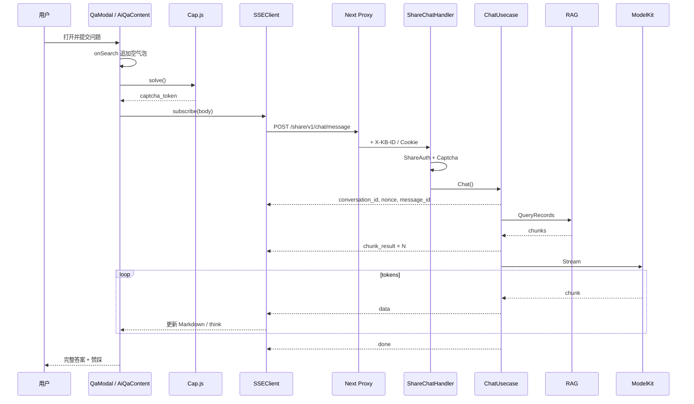
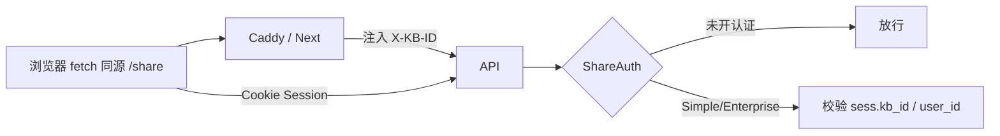

# PandaWiki 前台问答流程

本文档基于 `web/app` 与后端 Share Chat 相关代码，梳理用户从发起提问到流式展示答案的完整流程。主路径是 **站点内 QaModal 智能问答**；文末补充「仅搜索文档」、Widget、h5-chat 等旁路。

## 1. 总览



| 角色 | 技术点 |
|------|--------|
| UI 容器 | `QaModal`（Tabs：智能问答 / 仅搜索文档） |
| 主问答逻辑 | `AiQaContent.tsx`（会话状态 + Cap + SSE 均内联实现） |
| SSE 传输 | `utils/fetch.ts` 的 `SSEClient`（`fetch` + ReadableStream，**不是** `EventSource`） |
| 后端接口 | `POST /share/v1/chat/message`（`app_type=1` = Web） |
| 知识库上下文 | Header `X-KB-ID`（浏览器不写，由 Caddy / Next 代理注入） |
| 检索与生成 | RAG `RetrieveChunks` → 拼 Prompt → ModelKit 流式（见 [§5](#5-检索与生成rag--prompt--llm)） |

说明：`components/QaModal/hooks/useSSEChat.ts`、`useConversation.ts` 等 hook **当前未被主路径引用**，实际逻辑在 `AiQaContent` 内。

---

## 2. 入口：用户如何打开问答

| 入口 | 位置 | 行为 |
|------|------|------|
| Header 搜索 | `components/header/index.tsx` `handleSearch` | `type=chat` 时写入 `sessionStorage.chat_search_query`，`setQaModalOpen(true)` |
| Header QA 按钮 | `onQaClick` | 仅打开 Modal |
| Welcome Header | 同上 `WelcomeHeader` | 同 Header |
| 首页 Banner | `views/home/index.tsx` | chat 时写 `chat_search_query` 并开 Modal |
| URL `?ask=` | `QaModal` + `AiQaContent` mount | 自动打开 Modal 并提问 |
| URL `?cid=` | 同上 | 打开 Modal，拉取历史会话展示（不自动续聊同一 id） |
| Modal 内热搜 / 输入框 | `AiQaContent` | `onSuggestionClick` / `handleSearch` → `onSearch` |

全局开关：`provider/index.tsx` 中的 `qaModalOpen` / `setQaModalOpen`。  
`Header` / `WelcomeHeader` 内挂载 `<QaModal />`。

`QaModal`（`components/QaModal/index.tsx`）：

- 默认 Tab = `chat`（智能问答）
- 另一 Tab = `search`（仅搜索文档 → `SearchDocContent`）
- 打开时聚焦对应输入框；关闭后延迟把 Tab 复位为 `chat`
- 底部可展示免责声明 `disclaimer_settings.content`

---

## 3. 前端状态模型（AiQaContent）

### 3.1 单条对话项

```ts
interface ConversationItem {
  q: string;                    // 用户问题
  a: string;                    // 助手回答（流式累积后的正文）
  score: number;                // 赞/踩反馈
  update_time: string;
  message_id: string;           // 助手消息 ID（done 后固化）
  source: 'history' | 'chat';  // 历史回放 vs 本次会话
  chunk_result: ChunkResultItem[]; // RAG 引用
  thinking_content: string;     // <think> 内容
  id: string;                   // 前端本地 uuid
}
```

### 3.2 会话级状态

| 状态 | 作用 |
|------|------|
| `conversation[]` | 气泡列表 |
| `conversationId` | 后端会话 ID；有值时 URL 同步 `?cid=` |
| `nonce` | 续聊校验；后端首次下发，后续请求带回 |
| `messageIdRef` | 当前助手消息 ID（流式过程中累加） |
| `fullAnswer` | 含 `<think>` 的原始流式缓冲 |
| `loading` / `thinking` | 阶段：1 搜文档 → 2 思考 → 3 回答 → 4 结束 |
| `SSEClient` ref | 订阅 / 中止流 |

### 3.3 续聊与重置

- **首问**：`conversation_id`、`nonce` 为空，后端创建会话并经 SSE 下发  
- **续聊**：再次 `onSearch` 时带上已有 `conversationId` + `nonce`  
- **新会话** `onReset`：abort SSE，清空 id/nonce/列表  
- **历史 `?cid=`**：`getShareV1ConversationDetail` 还原消息，`source='history'`；若在历史视图上再提问，会**清空列表**开新聊（不沿用旧 cid 续聊）

---

## 4. 主路径逐步流程（智能问答）

### 阶段 A：打开并提交问题

```text
1. 用户点击 QA / 搜索 / 热搜 / 回车
2. setQaModalOpen(true)  [可选写入 sessionStorage.chat_search_query]
3. QaModal 渲染 AiQaContent
4. mount 时若存在 chat_search_query 或 ?ask=：
     - 清除 storage / URL 参数
     - onSearch(query, true)
   否则等待用户输入 → handleSearch → onSearch
```

`onSearch(q)`：

1. 防重入：`loading` 或空串则 return  
2. 开启智能滚动 `setShouldAutoScroll(true)`  
3. 构造新 `ConversationItem`（空答案）push 进列表；若当前是 history 视图则先清空  
4. 清空 `messageIdRef`、`fullAnswer`  
5. `setTimeout(() => chatAnswer(q), 0)`  

### 阶段 B：验证码（Cap.js）

`chatAnswer` 开头：

```text
setLoading(true); setThinking(1);  // 「正在搜索结果...」

window.CAP_CUSTOM_WASM_URL = origin + '/cap@0.0.6/cap_wasm.min.js'
import('@cap.js/widget') → new Cap({ apiEndpoint: '/share/v1/captcha/' })
cap.solve() → token
失败 → message.error('验证失败') 并 return
```

Cap 实际请求：

- `POST /share/v1/captcha/challenge`
- `POST /share/v1/captcha/redeem`

后端在 `ChatMessage` 内 `Captcha.ValidateToken`；失败则以 SSE `error` 返回（或在校验阶段直接 error 事件）。

### 阶段 C：发起 SSE 请求

请求体：

```json
{
  "message": "<用户问题>",
  "nonce": "<续聊时带上>",
  "conversation_id": "<续聊时带上>",
  "app_type": 1,
  "captcha_token": "<cap token>"
}
```

传输：

```text
SSEClient.subscribe(JSON.stringify(reqData), onEvent)
  → fetch POST /share/v1/chat/message
  → headers: Accept: text/event-stream, Content-Type: application/json
  → 超时 5 分钟；unsubscribe → AbortController.abort
```

**浏览器侧不设置 `X-KB-ID`**。链路大致为：

| 环境 | 如何到达 API |
|------|----------------|
| 开发 | Next `rewrites`：`/share/v1/*` → `TARGET`；或 Middleware 对 `/share/*` 代理并补 `x-kb-id`（`DEV_KB_ID`） |
| 生产 | 站点前的 Caddy 按 Host 注入 `X-KB-ID`，再转发到 API；Next Middleware 也可代理 `/share/*` |

Cookie（Share 登录会话）随同源 `fetch` 默认携带，供开启认证的 KB 使用。

### 阶段 D：后端处理（API 进程内同步）

入口：`handler/share/chat.go` → `ChatMessage`

```text
CORS 中间件
  → ShareAuthMiddleware.Authorize   # X-KB-ID + 可选 Session
  → Bind / Validate；强制 AppTypeWeb
  → Captcha.ValidateToken
  → 设置 SSE 响应头
  → 从 Session 取企业 user_id（若有）→ req.Info
  → chatUsecase.Chat → 读 channel，writeSSEEvent 直至 done/error
```

`ChatUsecase.Chat`（goroutine）顺序：

| 步 | 行为 |
|----|------|
| 1 | `GetOrCreateAppByKBIDAndType`（Web App） |
| 2 | `GetChatModel`（未配置则 SSE error 提示去后台配模型） |
| 3 | 创建会话或校验 `conversation_id + nonce`；下发 `conversation_id`、`nonce` |
| 4 | 下发 `message_id`；落库用户消息 |
| 5 | 问题敏感词 DFA（命中则 error 并落库固定答复） |
| 6 | 解析权限组 `groupIds` |
| 7 | `LLMUsecase.FormatConversationMessages`：历史 + System Prompt + **RAG QueryRecords**（详见 [§5](#5-检索与生成rag--prompt--llm)） |
| 8 | 对每个召回节点发 `chunk_result` |
| 9 | ModelKit `Stream`；`onChunk` 推 `data`（可选答案敏感词缓冲） |
| 10 | 落库 assistant、更新 Token 用量 |
| 11 | 发 `done` |

SSE 写入格式：

```text
data: {"type":"...","content":"...","chunk_result":{...}}\n\n
```

### 阶段 E：前端解析事件并渲染

`SSEClient.processChunk`：按行缓冲，遇空行 `JSON.parse` 后回调。

| SSE type | 前端处理 | UI 表现 |
|----------|----------|---------|
| `conversation_id` | `setConversationId(prev => prev + content)` | URL 同步 `?cid=` |
| `nonce` | `setNonce(prev => prev + content)` | 供续聊 |
| `message_id` | `messageIdRef.current += content` | done 时写入 conversation |
| `chunk_result` | 追加到最后一条的 `chunk_result[]` | Accordion「共找到 N 个结果」；点击 `window.open('/node/{node_id}')` |
| `data` | 拼入 `fullAnswer` → `handleThinkingContent` 拆 `<think>` | 思考折叠区 + Markdown 正文流式；状态 2/3 |
| `error` | loading 结束；答案追加 `<error>...`；`message.error` | 错误展示 |
| `done` | 固化 `message_id` / `update_time`；`loading=false` | 露出复制 / 赞踩等操作 |

思考内容拆分（`QaModal/utils.ts`）：

- 匹配 `<think>...</think>`（含未闭合）→ `thinking_content`
- 剩余 → 回答正文 `a`，用 `MarkDown2` 渲染

中止：`handleSearchAbort` → `unsubscribe` → `onCancel` 在答案后追加 `Request canceled`。

### 阶段 F：反馈（赞 / 踩）

开关：`kbDetail.settings.ai_feedback_settings.is_enabled`（默认 true）。  
仅 `source === 'chat'` 且存在 `message_id` 时展示。

```text
赞 → handleScore(message_id, 1)
踩 → 打开 Feedback Modal → handleScore(message_id, score, type, content)
  → POST /share/v1/chat/feedback
     { conversation_id, message_id, score [, type, feedback_content] }
```

---

## 5. 检索与生成（RAG → Prompt → LLM）

前台只负责发问题与收 SSE；**从知识库取内容、再经 LLM 整理答案**，全部在 API 进程内由 `ChatUsecase` → `LLMUsecase` 完成。这是典型的 RAG 链路。



### 5.1 从知识库取内容（检索）

入口：`LLMUsecase.FormatConversationMessages` → `GetRankNodes` → `CTRAG.QueryRecords`。

| 步 | 行为 | 关键代码 |
|----|------|----------|
| 1 | 从 PG 取会话消息，**最后一条 User** 作为 `question` | `conversationRepo.GetConversationMessagesByID` |
| 2 | 读取知识库，得到 RAG 侧 `DatasetID`（创建 KB 时建立） | `kbRepo.GetKnowledgeBaseByID` |
| 3 | 调用 RAG `RetrieveChunks` | `store/rag/ct/rag.go` `QueryRecords` |
| 4 | 用返回的 `DocumentID`（发布时写入的 `doc_id`）反查已发布节点 | `nodeRepo.GetNodeReleasesWithPathsByDocIDs` |
| 5 | 按文档聚合为 `RankedNodeChunks`（标题、摘要、路径、chunks） | `GetRankNodes` |

检索请求要点（`RetrievalRequest`）：

| 字段 | 含义 |
|------|------|
| `DatasetIDs` | 当前知识库 Dataset |
| `Question` | 用户问题 |
| `TopK` | 默认 10 |
| `UserGroupIDs` | 权限组，过滤不可见文档 |
| `ChatMessages` | 历史对话，供检索侧上下文 / 改写 |

**前提**：文档须在管理端**发布**，Consumer 完成向量 upsert 后，问答才能召回到内容。读的是已索引快照，不是草稿。

前端收到的 `chunk_result`（节点 ID / 名称 / 摘要）即本步召回结果的元信息，用于「共找到 N 个结果」与跳转 `/node/{id}`。

### 5.2 拼 Prompt（把片段交给模型）

召回片段不会直接当答案返回，而是格式化进 Prompt（`domain.FormatNodeChunks` + 模板）：

```text
System:
  默认 domain.SystemPrompt
  或该 KB 在 settings 中配置的 system_prompt
  —— 要求依据 documents 回答；不足则说不知道；
     引用格式 [[序号](URL)]；结束后可输出引用列表等

User:
  当前日期：{{.CurrentDate}}
  <question>{{.Question}}</question>
  <documents>
    <document>
    ID: {node_id}
    标题: {name}
    URL: {baseURL + path}
    内容:
    {各 chunk 文本；/static-file 图床会补 BaseURL}
    </document>
    ...
  </documents>

消息顺序：
  [System, ...历史 User/Assistant..., 带 Documents 的 User]
```

实现上：先用 GoTemplate 生成 System + 当前 User（含 Documents），再把「本轮之前」的历史消息插入到 System 之后（`slices.Insert(..., 1, history...)`）。

### 5.3 LLM 整理并流式输出

| 步 | 行为 |
|----|------|
| 1 | 管理台配置的 Chat 模型 → `ModelInfo.ToModelkitModel` → `modelkit.GetChatModel` |
| 2 | `LLMUsecase.ChatWithAgent`：`chatModel.Stream(messages)` |
| 3 | 思考内容包成 `<think>...</think>`，正文作为 SSE `data` |
| 4 | 可选：答案敏感词缓冲过滤（`CreateAcOnChunk`） |
| 5 | 落库 assistant 消息，更新 Token 用量，发 `done` |

前端对 `data` 做 `handleThinkingContent` 拆分后，用 Markdown 渲染正文；引用列表若出现在模型输出中，也会随 Markdown 展示。

### 5.4 与「仅搜索文档」、发布索引的对比

| 能力 | 检索 RAG | LLM 生成 |
|------|----------|----------|
| 智能问答 `/chat/message` | ✅ | ✅ |
| 仅搜索文档 `/chat/search` | ✅ | ❌（只返回 `node_result`） |
| 管理端发布 | 写入索引（Consumer upsert） | — |

| 阶段 | 进程 | 方向 |
|------|------|------|
| 发布建索引 | Consumer | 文档 → RAG Dataset |
| 问答检索 | API | 问题 → RAG 检索 → Prompt → LLM |

未发布或索引未完成时：常表现为无 `chunk_result`、或模型按「知识不足」兜底——优先查发布与 Consumer，而不是前端 SSE。

更完整的跨模块链路见 [服务端请求调用链路](./服务端请求调用链路.md) 中的 Share Chat 章节。

---

## 6. 时序图（主路径）



---

## 7. 「仅搜索文档」旁路

Tab：`SearchDocContent`（**非 SSE**）。

```text
Cap.solve()
  → POST /share/v1/chat/search
     { message, captcha_token }
  → JSON：{ node_result: [...] }
  → 列表展示；点击打开 /node/{id}
```

后端同样：`ShareAuth` + Captcha → `ChatUsecase.Search`（只做 §5.1 类检索，不走 §5.3 生成）。

与智能问答的差异：无会话、无流式、无 `conversation_id`，只返回文档命中列表。

---

## 8. 其它问答相关入口

### 8.1 网页挂件 Widget

| 项 | 说明 |
|----|------|
| 入口 | `public/widget-bot.js` → iframe `/widget` → `views/widget/index.tsx` |
| 接口 | `POST /share/v1/chat/widget`，`app_type=2` |
| 鉴权 | **不挂** `ShareAuthMiddleware`；校验 Widget 开关 |
| Captcha | **无** |
| 引用 | 前端基本不展示 `chunk_result` |
| 反馈 | `ChatWindow` 内赞踩，同 feedback API |

### 8.2 H5 Chat（微信客服回放）

| 项 | 说明 |
|----|------|
| 入口 | `/h5-chat?id=...` → `views/h5Chat/index.tsx` |
| 接口 | `GET /share/v1/app/wechat/service/answer?id=...` |
| 事件 | `question` / `answer` / `error` / `done` |
| 性质 | **回放已有答案**，非站点自由输入问答 |
| 反馈 | 无（另有独立 `/feedback` 页服务微信点赞链接） |

### 8.3 OpenAI 兼容 Completions

`POST /share/v1/chat/completions`：第三方集成，不经过 QaModal；内部仍复用聊天/模型能力。

---

## 9. 鉴权与知识库上下文



要点：

1. 前台页面级请求（Layout SSR）走 `httpClient`，401 会跳 `/auth/login`  
2. **问答 SSE 走裸 `fetch`，不走 `httpClient`**，401 时通常表现为 HTTP 错误 / 无流，**不会自动跳登录**  
3. 开启 KB 访问认证时，用户需先完成 Share 登录（Simple / OAuth / LDAP 等），否则问答可能失败  

默认未开访问认证时，**前台问答不需要登录**（仍要过 Cap 验证码）；开启 Simple / Enterprise Auth 后需先完成前台登录。

---

## 10. 实现细节与注意点

1. **`conversation_id` / `nonce` / `message_id` 用字符串累加**（`prev + content`），兼容后端分片推送；当前后端多为整段一次发送。  
2. **图片上传 UI 存在**（本地预览、粘贴），但 `chatAnswer` 请求体**未携带图片**，当前未接入多模态问答。  
3. Cap WASM 路径需可访问：`/cap@0.0.6/cap_wasm.min.js`（Next `headers` 对 cap 资源有长缓存）。  
4. 智能滚动：`useSmartScroll` 监听 `.conversation-container`，流式输出时自动贴底；用户上翻可打断自动滚。  
5. Modal 卸载时会 abort SSE、清理 URL 的 `cid`，并延迟 `onReset`。  

---

## 11. 排查清单

| 现象 | 排查点 |
|------|--------|
| 点问答无反应 | `qaModalOpen`、Header 是否挂载 `QaModal` |
| 卡在「正在搜索结果...」 | Cap 是否失败（控制台 / 网络 captcha）；验证失败时 loading 可能未复位 |
| HTTP 401/403 | `X-KB-ID`、Share 登录 Session、KB Forbidden |
| 提示未配置模型 | 管理台系统设置中的推理模型 |
| 无引用文档 | 文档是否已发布；Consumer / RAG 索引是否成功（见 §5.1 / §5.4） |
| 有引用无回答 | LLM / ModelKit 配置与网络；SSE `data`/`error` |
| 答非所问 / 总说知识不足 | 召回 chunk 是否相关；System Prompt；相似度与权限组 |
| 续聊失败 | `nonce` 是否丢失；是否用了 history 视图再提问导致会话被清空 |
| Widget 不可用 | Widget 开关、`/widget` Middleware 校验 |

---

## 12. 关键源码索引

| 主题 | 路径 |
|------|------|
| Modal 壳 | `web/app/src/components/QaModal/index.tsx` |
| 智能问答 UI + SSE | `web/app/src/components/QaModal/AiQaContent.tsx` |
| 仅搜索文档 | `web/app/src/components/QaModal/SearchDocContent.tsx` |
| 思考内容拆分 | `web/app/src/components/QaModal/utils.ts` |
| SSE 客户端 | `web/app/src/utils/fetch.ts` |
| Header 入口 | `web/app/src/components/header/index.tsx` |
| 全局 Modal 状态 | `web/app/src/provider/index.tsx` |
| Share Chat API 定义 | `web/app/src/request/ShareChat.ts`、`ShareChatSearch.ts`、`ShareCaptcha.ts` |
| 反馈组件 | `web/app/src/components/feedback/index.tsx` |
| Widget | `web/app/src/views/widget/index.tsx` |
| 后端 Chat Handler | `backend/handler/share/chat.go` |
| 后端 Chat Usecase | `backend/usecase/chat.go` |
| Prompt 拼装 / 检索聚合 / 流式 | `backend/usecase/llm.go`（`FormatConversationMessages`、`GetRankNodes`、`ChatWithAgent`） |
| Prompt 模板与 Documents 格式化 | `backend/domain/llm.go` |
| RAG 检索适配 | `backend/store/rag/ct/rag.go` `QueryRecords` |
| Share 鉴权 | `backend/middleware/share_auth.go` |
| SSE 事件结构 | `backend/domain/sse_event.go` |

---

## 13. 一句话总结

前台问答 = **打开 QaModal → Cap → SSE `/share/v1/chat/message` → ShareAuth → 会话落库 → RAG 按 Dataset 召回片段 → 拼 System/Documents/Question → LLM 流式生成 → 前端渲染引用与 Markdown → 可赞踩**。  
「仅搜索文档」只做检索不生成；Widget / h5-chat 为独立入口。索引在发布时由 Consumer 写入，问答时由 API 同步读取。
