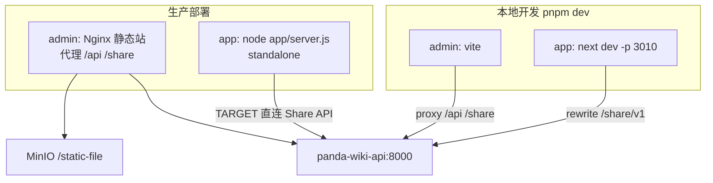
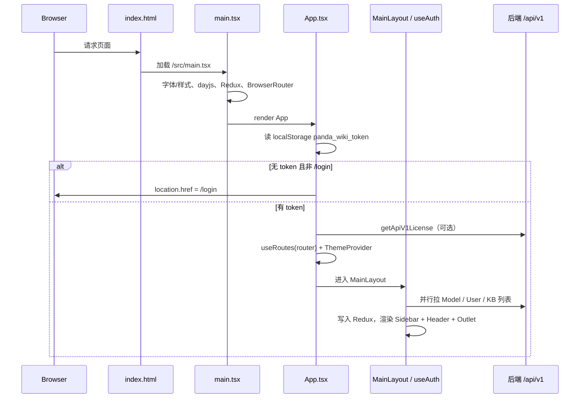

# PandaWiki 前端启动流程

本文档梳理前端 Monorepo 的本地开发与运行时启动链路，覆盖 **管理后台（admin）** 与 **用户前台（app）** 两条独立应用，并说明共享包、代理与部署形态。

## 1. 双端总览

| 应用 | 目录 | 技术栈 | 默认端口 | 服务对象 | 主要对接 API |
|------|------|--------|----------|----------|--------------|
| 管理后台 | `web/admin` | Vite 6 + React 19 + React Router 7 + Redux Toolkit | Vite 默认（开发）/ Nginx 8080（部署） | 管理员 | `/api/v1/*` |
| Wiki 前台 | `web/app` | Next.js 15 App Router（Turbopack 开发） | `3010` | 访客 / 终端用户 | `/share/v1/*` |
| 共享包 | `web/packages/*` | workspace 包 | — | 两端复用 | `@panda-wiki/ui` / `themes` / `icons` |

根目录脚本（`web/package.json`）：

```bash
pnpm dev    # 并行启动 admin + app
pnpm build  # 并行构建 admin + app
```

工作区定义见 `web/pnpm-workspace.yaml`：`app`、`admin`、`packages/*`。



---

## 2. 管理后台启动流程（`web/admin`）

管理后台是 **纯 CSR 的 SPA**：浏览器加载 `index.html` → 执行 `main.tsx` → 客户端路由与鉴权。

### 2.1 开发 / 构建入口

| 命令 | 行为 |
|------|------|
| `pnpm --filter panda-wiki-admin dev` / `vite` | 启动 Vite Dev Server，`host: 0.0.0.0`，HMR |
| `pnpm --filter panda-wiki-admin build` | `tsc -b && vite build` → 产出静态资源到 `dist` |

`vite.config.ts` 关键代理（依赖环境变量，如 `TARGET`、`STATIC_FILE_TARGET`、`SHARE_TARGET`）：

| 前缀 | 用途 |
|------|------|
| `/api` | 管理端 API |
| `/share` | 分享相关接口（开发联调） |
| `/static-file` | 对象存储静态文件 |

### 2.2 浏览器运行时链路



#### 步骤拆解

1. **`index.html`**  
   挂载 `#root`，引入 `/src/main.tsx` 与 `/panda-wiki.css`。

2. **`src/main.tsx`（应用根引导）**  
   - 引入全局字体、CSS、iconfont  
   - 配置 dayjs（中文、`duration` / `relativeTime`）  
   - `createRoot` 渲染树：

     ```text
     BrowserRouter
       └── Redux Provider(store)
             └── App
     ```

3. **`src/App.tsx`（鉴权门禁 + 主题）**  
   - `useRoutes(router)` 渲染路由表  
   - Token：`localStorage.panda_wiki_token`  
   - 无 token 且非登录页 → 硬跳转 `/login`  
   - 有 token → 拉取 License 写入 `config` slice  
   - `@ctzhian/ui` 的 `ThemeProvider` 包裹路由视图  

4. **`src/router.tsx`（路由表）**  
   页面均 `React.lazy` + `Suspense`（顶部 `LinearProgress`）：

   | 布局 | 路径 | 页面 |
   |------|------|------|
   | `MainLayout`（侧栏+顶栏） | `/` | 文档管理 |
   | | `/setting` | 设置 |
   | | `/contribution` | 贡献 |
   | | `/release` | 发布 |
   | | `/stat` | 统计 |
   | | `/conversation` | 会话 |
   | | `/feedback/:tab?` | 反馈 |
   | `NoSidebarHeaderLayout(hasAuth)` | `/doc/editor/...` | 文档编辑器 |
   | `NoSidebarHeaderLayout(无鉴权初始化)` | `/login`、`/401` | 登录 / 无权限 |

5. **`layouts` 的 `useAuth`（登录后数据预热）**  
   `MainLayout` / 需鉴权的编辑布局在挂载时并行请求：

   - `getApiV1ModelList` → 判断 chat/embedding/rerank 是否齐全  
   - `getApiV1User` → 当前用户  
   - `getApiV1KnowledgeBaseList` → KB 列表，恢复 `localStorage.kb_id`  

   若普通用户且无任何知识库 → 跳转 `/401`。

6. **登录页**  
   `postApiV1UserLogin` 成功后写入 `panda_wiki_token`，再 `navigate` 到 redirect 或 `/`。

### 2.3 状态与请求

| 模块 | 说明 |
|------|------|
| Redux Store | `config`（用户、KB、模型、License 等）、`breadcrumb` |
| HTTP | Swagger 生成的 `request/*` + `httpClient`；请求头带 Bearer Token；401 清 token |
| 主题 | `src/themes` + `@ctzhian/ui` ThemeProvider |

### 2.4 生产部署形态

`admin/Dockerfile`：Nginx Alpine，拷贝 `dist` 到 `/opt/frontend/dist`。

`server.conf` 要点：

- 监听 **8080 SSL**（证书目录由后端 `setup.CheckInitCert` 等提供）  
- `/api`、`/share` → `panda-wiki-api:8000`（SSE 类路径关闭缓冲）  
- `/static-file` → MinIO  
- `/` → SPA `try_files` 回退 `index.html`  

因此生产环境 **浏览器只访问 Nginx**；管理台静态资源与 API 同源反代。

---

## 3. Wiki 前台启动流程（`web/app`）

前台是 **Next.js App Router** 应用：存在 **Edge/Node Middleware → RSC Layout 服务端取数 → 客户端 Hydration** 多层启动。

### 3.1 开发 / 构建入口

| 命令 | 行为 |
|------|------|
| `pnpm --filter panda-wiki-app dev` | `next dev --turbopack -p 3010` |
| `pnpm --filter panda-wiki-app build` | `next build`，`output: 'standalone'`，产物目录 `dist` |
| `next start` / Docker | 生产 Node 服务，`PORT=3010` |

关键配置（`next.config.ts`）：

- `output: 'standalone'`，`distDir: 'dist'`  
- 开发环境 `rewrites`：`/share/v1/*`、`/static-file/*` 代理到 `TARGET` / `STATIC_FILE_TARGET`  
- 生产环境包一层 `@sentry/nextjs`（开发跳过）  

环境变量示例（`app/.env`）：

```text
TARGET=http://panda-wiki-api:8000
```

本地还可配合 `DEV_KB_ID`（中间件 / 服务端请求注入 `x-kb-id`）。

### 3.2 请求进入后的分层

```mermaid
flowchart TD
  Req[浏览器请求] --> MW[src/middleware.ts]
  MW -->|/widget| WidgetCheck[校验挂件是否开启]
  MW -->|/share/*| Proxy[代理到 TARGET API]
  MW -->|文档站路径| HomeMW[middleware/home.ts]
  HomeMW -->|path=/| Rewrite[按首页配置 rewrite<br/>/home 或 /node/:id]
  HomeMW -->|其它| Stat[页面访问统计] --> Next[NextResponse.next]
  Next --> RootLayout[app/layout.tsx RSC]
  RootLayout --> PagesLayout[app/(pages)/layout.tsx]
  PagesLayout --> Page[具体 page.tsx]
  Page --> Client[客户端组件 Hydration]
```

### 3.3 Middleware（最先执行）

文件：`src/middleware.ts`，matcher 覆盖 `/`、`/home`、`/node`、`/welcome`、`/auth/login`、`/widget`、`/share/*` 等。

主要职责：

1. **Session Cookie**  
   无 `x-pw-session-id` 则生成 UUID，写入 HttpOnly Cookie（1 年）。

2. **`/widget`**  
   拉取挂件配置；未开启则 rewrite 到 `/not-fount`。

3. **`/share/*`**  
   在 Middleware 内直接 `fetch` 转发到 `process.env.TARGET`（并带上 `x-kb-id`），用于同源 Share API 访问。

4. **站点路径** → `middleware/home.ts`  
   - `/`：读 `home_page_setting`  
     - `custom` → rewrite `/home`（自定义落地页）  
     - 否则取文档树第一个节点 → rewrite `/node/:id`（无节点则 `/node`）  
   - 对 welcome/node/chat/auth 等场景异步上报 `postShareV1StatPage`  
   - 捕获需登录的 `NEXT_REDIRECT` → 跳转 `/auth/login?redirect=...`

5. **透传当前路径**  
   非 share 请求设置 `x-current-path` / `x-current-search`，供服务端 HTTP 客户端做登录回跳。

### 3.4 根 Layout（`app/layout.tsx`）

服务端组件，整站外壳：

1. `generateMetadata`：调 `getShareV1AppWebInfo` 设置 title / icon / OG  
2. 读 Cookie `theme_mode`、UA 判断移动端  
3. 并行：`getShareV1AppWebInfo` + `getShareProV1AuthInfo`  
4. Auth 403 → 渲染 `ErrorComponent`，否则渲染 `children`  
5. Provider 嵌套：

   ```text
   AppRouterCacheProvider（MUI + Next）
     └── ThemeStoreProvider（亮/暗主题 + Cookie 持久化）
           └── StoreProvider（kbDetail / authInfo / mobile 等）
   ```

6. 本地字体 `gilory` 注入 CSS 变量  

生产环境另经 `instrumentation.ts` 按 runtime 加载 Sentry。

### 3.5 业务 Layout 与页面

| 层级 | 文件 | 启动时行为 |
|------|------|-----------|
| `(pages)/layout` | 再拉 KB 信息与节点列表，转树形目录；注入自定义 `head_code` / `body_code`；`StoreProvider` 补齐 `nodeList` / `tree` | RSC |
| `(doc)/layout` | 水印 `WaterMarkProvider` | — |
| `/home` | 自定义欢迎页（客户端主题来自 KB landing theme） | Client |
| `/node/[id]` | SSR 拉 `getShareV1NodeDetail`，生成 Metadata，渲染文档视图 | RSC |
| `/auth/login` | 前台登录 | — |
| `/widget` | 网页挂件 | 独立 layout |
| `/h5-chat` | H5 聊天 | — |
| `/feedback` | 反馈 | 独立 layout |
| `/editor/[[...id]]` | 前台侧编辑相关 | — |

视图实现多在 `src/views/*`，`page.tsx` 负责取数与装配。

### 3.6 服务端 / 客户端请求

`HttpClient`（`src/request/httpClient.ts`）：

- `baseUrl = process.env.TARGET`  
- **服务端**：通过 `getServerHeader()` 注入 `x-kb-id`、Cookie；401 时用 middleware 写入的 path 做 `redirect` 登录  
- **浏览器**：401 跳转 `/auth/login?redirect=...`  
- API 模块为 Share 域：`ShareApp`、`ShareNode`、`ShareChat`、`ShareAuth` 等（及 `request/pro`）

与管理台差异：前台默认走 **Share API + 知识库维度（x-kb-id）**，管理台走 **JWT + /api/v1**。

### 3.7 生产部署形态

`app/Dockerfile`：

- 基于 `node:20-alpine`  
- 拷贝 `dist/standalone` + `dist/static` + `public`  
- `CMD ["node", "app/server.js"]`，`PORT=3010`  

即前台以 **Next standalone Node 进程** 运行，服务端组件在请求时直连 `TARGET`（API）。

---

## 4. 两端对比（启动视角）

| 维度 | 管理后台 admin | Wiki 前台 app |
|------|----------------|---------------|
| 框架模型 | SPA（Vite） | SSR/RSC（Next.js） |
| 首屏数据 | 浏览器挂载后再请求 | Middleware + Layout/Page 服务端预取 |
| 鉴权 | `panda_wiki_token`（localStorage） | Cookie Session + Share Auth；401 跳转登录 |
| 知识库上下文 | Redux `kb_id` + localStorage | 请求头 `x-kb-id`（网关/环境注入） |
| 开发代理 | Vite `server.proxy` | Next `rewrites` + Middleware 代理 `/share` |
| 生产载体 | Nginx 静态 + 反代 API | Node standalone |
| 观测 | （相对轻） | Sentry（生产） |
| 共享 UI | 间接（主题/图标等） | 直接使用 `@panda-wiki/ui`、`@panda-wiki/themes` 等 |

---

## 5. 共享包在启动中的位置

| 包 | 角色 |
|----|------|
| `@panda-wiki/ui` | 前台落地页/区块组件（banner、faq、header 等），由 app 页面按需引用 |
| `@panda-wiki/themes` | 主题 palette（如 home 页 `THEME_TO_PALETTE`） |
| `@panda-wiki/icons` | 图标；根脚本 `pnpm icon` 生成 |

根 `web/package.json` 将三者与 React、MUI、`@ctzhian/ui`、`@ctzhian/tiptap` 等提升为 workspace 依赖，**dev/build 时由 pnpm 链接进 admin/app**，无单独“启动进程”。

---

## 6. 推荐本地启动顺序

1. 后端 API（及 PG/Redis/NATS 等）已可用  
2. 在 `web/` 安装依赖：`pnpm install`  
3. 配置：  
   - admin：Vite 所需 `TARGET` 等（见 `vite.config.ts` / 本地 `.env`）  
   - app：`TARGET`（及可选 `DEV_KB_ID`、`STATIC_FILE_TARGET`）  
4. `pnpm dev` 并行启动两端，或分别：  
   - 管理台：`pnpm --filter panda-wiki-admin dev`  
   - 前台：`pnpm --filter panda-wiki-app dev`（`http://localhost:3010`）  

排查建议：

- **Admin 白屏/一直跳登录**：检查 `panda_wiki_token` 与 `/api` 代理是否指向正确 API  
- **App 首页空白或一直 loading**：检查 Middleware 是否能访问 `TARGET`、`x-kb-id` / `DEV_KB_ID` 是否有效  
- **前台 401 循环**：Share 鉴权与 Cookie；对照 `middleware/home` 的 redirect 逻辑  

---

## 7. 关键源码索引

| 主题 | 路径 |
|------|------|
| Monorepo 脚本 | `web/package.json`、`web/pnpm-workspace.yaml` |
| Admin 入口 | `web/admin/index.html`、`src/main.tsx`、`src/App.tsx` |
| Admin 路由 / 布局 | `web/admin/src/router.tsx`、`src/layouts/index.tsx` |
| Admin Vite / Nginx | `web/admin/vite.config.ts`、`server.conf`、`Dockerfile` |
| App Middleware | `web/app/src/middleware.ts`、`src/middleware/home.ts` |
| App 根布局 | `web/app/src/app/layout.tsx` |
| App 业务布局 | `web/app/src/app/(pages)/layout.tsx` |
| App Next 配置 | `web/app/next.config.ts` |
| App 请求头 | `web/app/src/utils/getServerHeader.ts`、`src/request/httpClient.ts` |
| App 部署 | `web/app/Dockerfile` |
| 共享包 | `web/packages/ui`、`themes`、`icons` |

---

## 8. 一句话总结

- **管理后台**：Vite 拉起 SPA → `main` 挂载 Router/Redux → `App` 用 Token 门禁 → Layout 预拉用户/模型/知识库后进入业务页；生产由 Nginx 托管静态并反代 API。  
- **用户前台**：Next 进程处理请求 → Middleware 定会话、首页 rewrite、代理 Share → 根 Layout RSC 拉站点与鉴权信息 → 页面级再取文档数据 → 客户端 Hydration；生产以 standalone Node 运行并直连 API。
