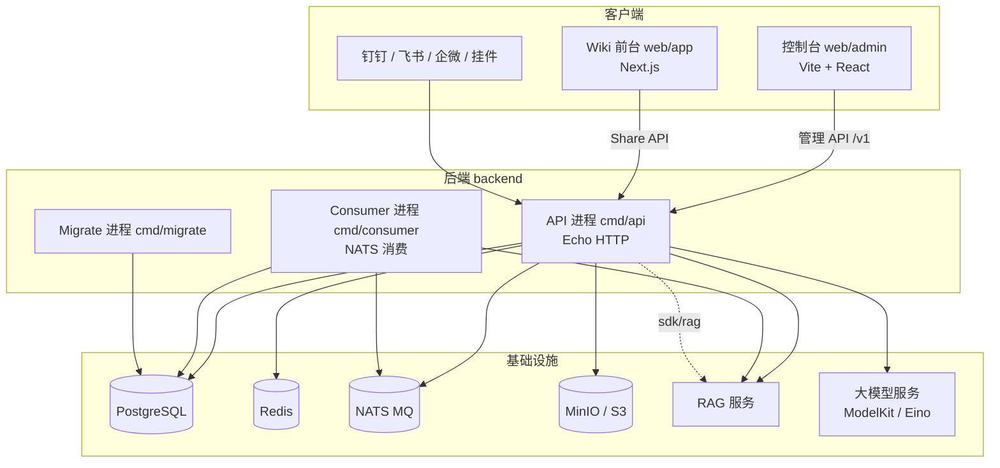
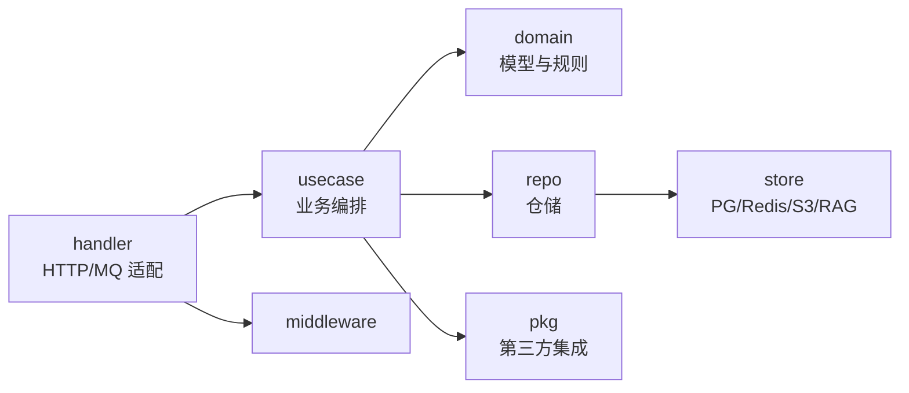
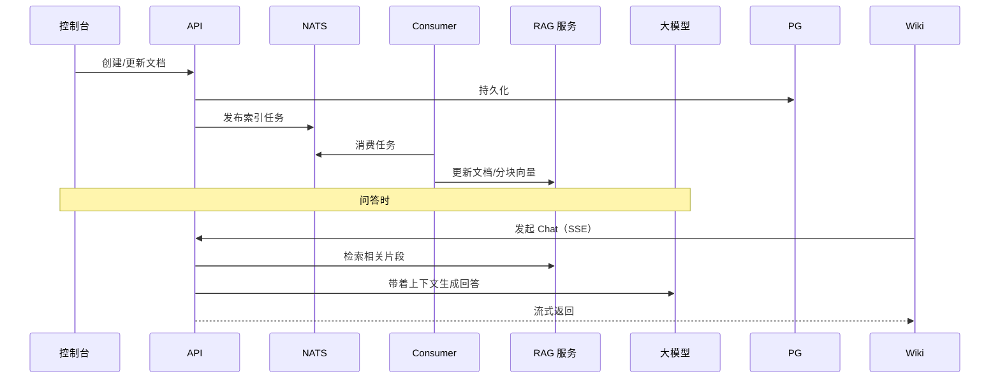
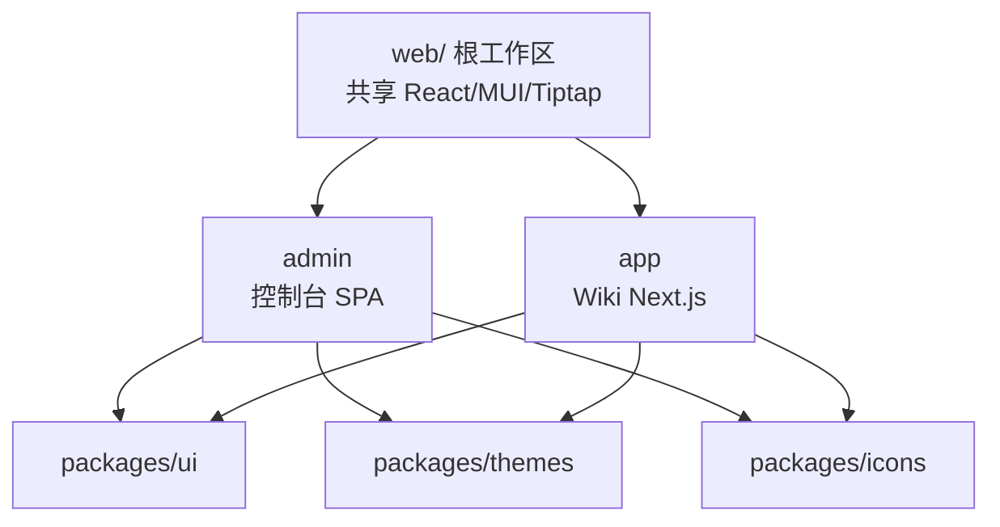
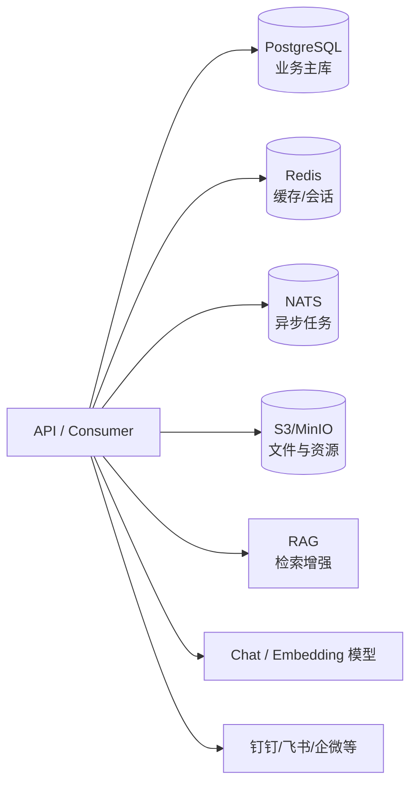

# PandaWiki 技术架构

本文档梳理 PandaWiki 的整体技术架构、核心技术选型、分层设计与主要数据流。

## 1. 系统定位

PandaWiki 是 **AI 大模型驱动的知识库搭建系统**，典型使用方式：

1. 管理员在 **控制台** 配置 AI 模型、创建知识库、编写/导入文档并发布。
2. 终端用户访问 **Wiki 网站** 阅读文档，使用 AI 搜索与 AI 问答。
3. 可进一步集成：网页挂件、钉钉/飞书/企微机器人、OpenAPI 等。

---

## 2. 总体架构

### 运行时角色

| 组件 | 说明 |
|------|------|
| **panda-wiki-api** | 同步业务入口：鉴权、知识库/文档 CRUD、聊天 SSE、文件上传、第三方回调等 |
| **panda-wiki-consumer** | 异步任务：RAG 索引更新、定时任务等 |
| **migrate** | Schema / 数据迁移 |
| **web/admin** | 管理控制台 SPA |
| **web/app** | 面向访客的 Wiki 站点（SSR/App Router） |

官方部署以 Docker 为主（Linux + Docker 20.x+），通过安装脚本拉起整套服务。

---

## 3. 技术选型一览

### 3.1 后端

| 类别 | 技术 |
|------|------|
| 语言 | Go 1.24 |
| Web 框架 | [Echo v4](https://echo.labstack.com/) |
| 依赖注入 | Google Wire |
| ORM / DB | GORM + PostgreSQL |
| 迁移 | golang-migrate |
| 缓存 / Session | Redis（go-redis、redistore） |
| 消息队列 | NATS |
| 对象存储 | MinIO（S3 兼容） |
| API 文档 | swaggo / Swagger |
| 配置 | Viper |
| AI / LLM | ModelKit、CloudWeGo Eino、tiktoken 等 |
| RAG | 自研 `sdk/rag` 客户端对接 RAG 服务 |
| 观测 | OpenTelemetry、Sentry |
| 认证 | JWT、Session、OAuth、LDAP、CAS 等 |

### 3.2 前端

| 类别 | 技术 |
|------|------|
| 包管理 / Monorepo | pnpm workspace |
| 控制台 | React 19 + Vite 6 + React Router 7 + Redux Toolkit |
| Wiki 前台 | Next.js 15（Turbopack 开发）+ React 19 |
| UI | MUI 7 + Emotion + `@ctzhian/ui` |
| 富文本 | `@ctzhian/tiptap`、ProseMirror；协作相关含 Yjs |
| Markdown | react-markdown / markdown-it、KaTeX、Mermaid、highlight.js |
| HTTP | axios；可由 Swagger 生成客户端（`cx-swagger-api`） |
| 图表（控制台） | ECharts |
| 监控（前台） | Sentry Next.js SDK |

### 3.3 SDK

| 模块 | 说明 |
|------|------|
| `sdk/rag` | Go 模块，封装 Dataset / Document / Chunk / Retrieval 等 RAG HTTP/API 调用 |

---

## 4. 后端分层架构

整体接近 **Clean Architecture / 用例驱动** 分层，单向依赖：

| 层 | 目录 | 职责 |
|----|------|------|
| 入口 | `cmd/*` | 组装应用、启动 HTTP 或 Consumer |
| 传输 | `handler/*`、`middleware/`、`server/http` | 路由、校验、鉴权、协议转换 |
| 用例 | `usecase/` | 业务流程：创建知识库、发布文档、问答链路等 |
| 领域 | `domain/` | 实体、请求/响应结构、领域错误 |
| 仓储 | `repo/` | 持久化与缓存读写抽象的实现 |
| 基础设施 | `store/`、`mq/`、`pkg/`、`config/` | 外部系统适配 |

### 4.1 API 分组（逻辑视角）

| 分组 | 典型目录 | 使用者 |
|------|----------|--------|
| 管理端 V1 | `handler/v1` | `web/admin` |
| Share / 前台 | `handler/share` | `web/app`、挂件、部分机器人 |
| OpenAPI | `handler/share` / `api/openapi` | 第三方集成 |
| MQ | `handler/mq` | Consumer 进程内部 |

管理端能力覆盖：用户/认证、知识库与成员、文档节点、文件、模型配置、AI 创作、爬虫导入、会话、评论、统计等。

### 4.2 异步与 AI 链路（概念）

（具体接口名以 `backend/docs/swagger.yaml` 为准。）

---

## 5. 前端架构

### 5.1 Monorepo 关系

### 5.2 控制台 `web/admin`

- **构建**：Vite，开发/生产分离构建脚本。
- **状态**：Redux Toolkit（`src/store`）。
- **路由**：React Router，页面按业务拆分（文档、发布、统计、会话、设置等）。
- **编辑**：Tiptap 富文本 + Markdown 相关组件；支持拖拽排序、上传、协作相关依赖（Yjs）。
- **API**：`src/request` + Swagger 生成，对接后端管理 API。

### 5.3 Wiki 前台 `web/app`

- **框架**：Next.js 15 App Router（开发默认端口 3010）。
- **能力**：文档浏览、目录、Markdown/HTML 渲染、问答弹层、挂件（widget）、H5 Chat、反馈页。
- **API**：主要调用后端 Share 侧接口；支持 Cookie/鉴权场景。
- **体验**：响应式（含 `react-device-detect`）、数学公式、代码高亮、Mermaid 等。

### 5.4 与后端的分工

| 前端 | 后端入口倾向 | 典型场景 |
|------|--------------|----------|
| admin | `/` 下管理 API（V1） | 建库、写文档、配模型、看统计 |
| app | Share / 公开访问相关 API | 读文档、AI 问答、挂件嵌入 |

---

## 6. 数据与外部依赖

配置项集中在 `backend/config`（日志、HTTP、PG、MQ、RAG、Redis、Auth、S3、Sentry、Caddy API 等），由环境/配置文件经 Viper 注入。

---

## 7. 工程与交付

### 7.1 代码生成

`backend/Makefile` 中常见流程：

- `swag`：从 handler 注释生成 Swagger（`backend/docs`）。
- `wire`：为 `api` / `consumer` / `migrate` 生成依赖注入代码。
- 专业版另有 `generate_pro`（依赖 `backend/pro` 子模块）。

### 7.2 容器镜像

| Dockerfile | 产物角色 |
|------------|----------|
| `Dockerfile.api` | API 服务镜像 |
| `Dockerfile.consumer` | Consumer 镜像 |
| `*.pro` | 专业版对应镜像 |

### 7.3 CI

`.github/workflows/` 包含后端与前端检查流水线（如 `backend.yml`、`web.yml`、`backend_check.yml`）。

### 7.4 开源版 vs 专业版

- 开源主体在本仓库 `backend` + `web`。
- `backend/pro` 为 Submodule（`PandaWikiPro`），承载专业版扩展；未拉取时不影响理解开源主链路。

---

## 8. 核心业务域（便于读代码）

| 业务域 | 后端线索 | 前端线索 |
|--------|----------|----------|
| 知识库 KB | `usecase/knowledge_base.go`、`handler/v1/knowledge_base.go` | admin 创建/设置知识库 |
| 文档节点 Node | `usecase/node.go`、`handler/v1/node.go` | admin `pages/document`；app 文档路由 |
| AI 模型 / LLM | `usecase/model.go`、`llm.go` | admin 设置中的模型配置 |
| 对话问答 | `usecase/chat.go`、`conversation.go`；`handler/share/chat.go` | app 问答组件；admin 会话页 |
| 内容导入 | `usecase/crawler.go`、`sitemap.go` | admin 导入相关 UI |
| 机器人集成 | `usecase/dingtalk_bot.go`、`wechat_*.go`；`pkg/*` | 设置页集成配置 |
| 统计 | `usecase/stat.go` | admin `pages/stat` |
| RAG 索引 | `handler/mq/rag*.go`、`store/rag`、`sdk/rag` | 对用户透明，文档变更后异步生效 |

---

## 9. 阅读代码建议路径

1. **部署与进程**：`backend/cmd/api` → `server/http` → `handler/v1` / `handler/share`。
2. **一条业务线**：选「知识库」或「文档节点」，从 handler → usecase → repo/pg → domain。
3. **AI 问答**：`handler/share/chat` → usecase chat/llm → `store/rag` + 模型调用。
4. **异步索引**：文档写入后的 MQ 消息 → `cmd/consumer` → `handler/mq`。
5. **控制台页面**：`web/admin/src/pages` + `src/request`。
6. **前台页面**：`web/app/src/app` + `src/components` + `src/request`。
7. **接口契约**：`backend/docs/swagger.yaml`。

---

## 10. 架构特点小结

1. **前后端分离**：管理台与 Wiki 前台独立应用，共享设计系统包。
2. **同步 + 异步**：API 处理在线请求，Consumer 处理 RAG/定时等耗时任务。
3. **AI 原生**：模型配置、创作、检索增强问答贯穿产品主路径。
4. **可集成**：机器人、OAuth/LDAP、挂件、OpenAPI，扩展集中在 `pkg` 与 share handler。
5. **可观测**：Sentry + OpenTelemetry，便于生产排障。

更细的目录职责见 [目录结构说明](./目录结构说明.md)。
