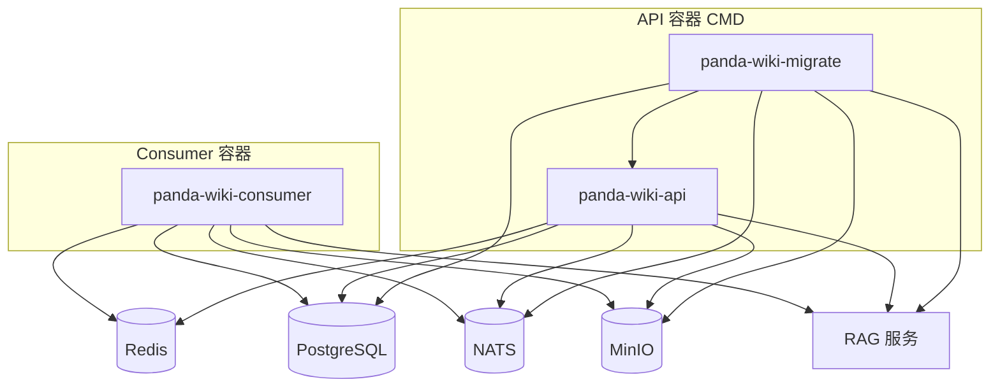
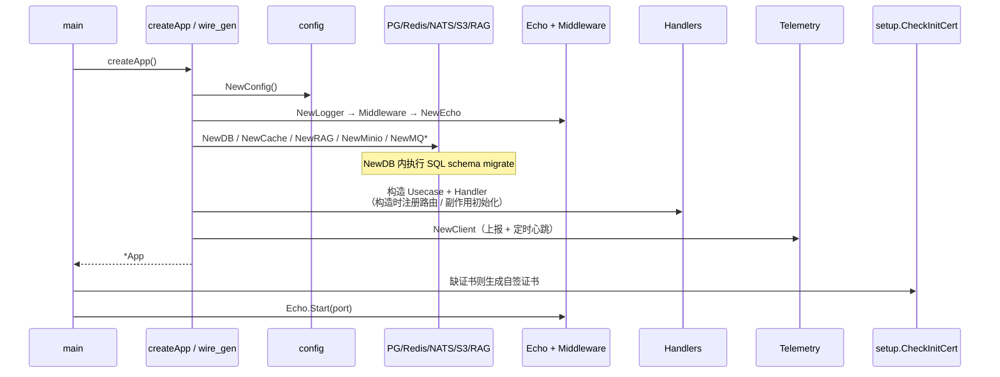
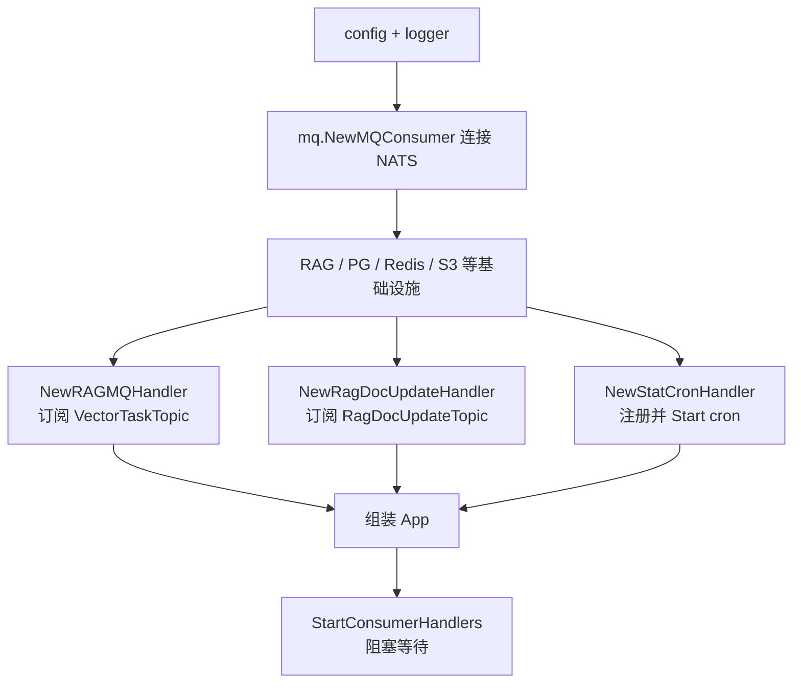

# PandaWiki 服务端启动流程

本文档从服务端入口（`backend/cmd/*`）出发，梳理 API、Consumer、Migrate 三个进程的组装与启动顺序，便于排查启动失败与理解依赖注入（Wire）装配过程。

## 1. 进程总览

后端有三个独立可执行入口：

| 入口 | 二进制（构建产物） | 职责 |
|------|-------------------|------|
| `cmd/api` | `panda-wiki-api` | HTTP API（Echo），对外提供管理端与 Share/OpenAPI |
| `cmd/consumer` | `panda-wiki-consumer` | NATS 消费 + 定时任务 |
| `cmd/migrate` | `panda-wiki-migrate` | Go 侧数据迁移（业务数据修复/升级） |

官方 API 镜像的启动命令为「先迁移、再起 API」：

```text
/app/panda-wiki-migrate && /app/panda-wiki-api
```

见 `backend/Dockerfile.api`。Consumer 镜像则直接执行 `./panda-wiki-consumer`。

三个进程的共同模式：

```text
main() → createApp()（Wire 注入）→ 执行进程专属启动动作
```

`createApp()` 由 `wire.go` 声明依赖图，由 `wire_gen.go` 生成具体构造顺序。运行时真正执行的是 `wire_gen.go`。

---

## 2. 总体启动关系



说明：

- **Schema 迁移**（`golang-migrate`，SQL 文件在 `backend/migration/`）发生在 `store/pg.NewDB` 内，API / Consumer / Migrate 任一进程连库时都会执行。
- **业务数据迁移**（`migration.Manager`）仅由 `cmd/migrate` 显式执行。
- API 进程也会创建 MQ Producer/Consumer（用于发向量任务、爬虫回调等），但 **向量索引等重活由 Consumer 进程订阅处理**。

---

## 3. API 进程启动流程（`cmd/api`）

入口：`backend/cmd/api/main.go`。

```go
func main() {
    app, err := createApp()          // Wire 组装整棵依赖树
    setup.CheckInitCert()            // 检查/生成 Nginx 用自签证书
    app.HTTPServer.Echo.Start(":port")
}
```

### 3.1 阶段划分



### 3.2 `createApp()` 装配顺序（按 `wire_gen.go`）

下列顺序即 Wire 生成代码中的构造依赖顺序，启动失败时按此排查即可。

| 步骤 | 组件 | 关键副作用 |
|------|------|-----------|
| 1 | `config.NewConfig()` | 默认值 → 读 `config.yml` → 环境变量覆盖 |
| 2 | `log.NewLogger` | 按 `log.level` 创建 slog |
| 3 | `middleware.NewReadonlyMiddleware` | 只读模式中间件 |
| 4 | `cache.NewCache` | 连接 Redis 并 `Ping` |
| 5 | `middleware.NewSessionMiddleware` | Redis Session Store；必要时生成 Session 密钥 |
| 6 | `http.NewEcho` | 初始化 Echo、Sentry、请求日志、只读/Session 中间件；`ENV=local` 时挂载 Swagger |
| 7 | `pg.NewDB` | 连 PG；若不存在则创建 `raglite` 库；执行 `file://migration` SQL Up |
| 8 | 各类 PG Repo + `middleware.NewAuthMiddleware` | JWT / Token 鉴权就绪 |
| 9 | `rag.NewRAGService` | 按 `rag.provider`（默认 `ct`）创建 RAG 客户端 |
| 10 | `mq.NewMQProducer` | 连 NATS，并 `EnsureStreams`（task / scraper / rag） |
| 11 | Usecase 层 | 见下方「构造期副作用」 |
| 12 | V1 / Share Handlers | **在构造函数内注册 Echo 路由** |
| 13 | `mq.NewMQConsumer` + Crawler | API 侧也可订阅爬虫导出 Topic（懒订阅） |
| 14 | `telemetry.NewClient` | 读取/写入 machine id，立即上报，并启动小时级周期上报 |
| 15 | 组装 `App` 返回 | — |

`App` 结构：

```text
App
├── HTTPServer    *http.HTTPServer   // Echo
├── Handlers      *v1.APIHandlers    // 管理端 API
├── ShareHandlers *share.ShareHandler // 前台/分享/OpenAPI
├── Config
├── Logger
└── Telemetry
```

### 3.3 配置加载（`config.NewConfig`）

优先级（后者覆盖前者中的敏感项）：

1. 代码内默认值（含默认 DSN、端口 `8000`、内网 `SUBNET_PREFIX` 等）
2. 配置文件：当前目录或 `./config` 下的 `config.yml`（可缺失）
3. 环境变量覆盖（如 `PG_DSN`、`JWT_SECRET`、`REDIS_ADDR`、`NATS_PASSWORD`、`ADMIN_PASSWORD`、`LOG_LEVEL` 等）

### 3.4 HTTP 层初始化（`http.NewEcho`）

1. 可选初始化 Sentry
2. `echo.New()`，隐藏 Banner/Port
3. 自定义 Binder（GET/DELETE 绑 Query，其它绑 Body）
4. 注册 Validator
5. 中间件链：Sentry（可选）→ OTel（`apm.enabled`）→ RequestLogger → ReadOnly → Session
6. 本地环境额外暴露 `/swagger/*`

注意：此时 **尚未注册业务路由**。路由在各 `NewXxxHandler` 构造时挂到同一个 `*echo.Echo` 上。

### 3.5 Handler 注册机制

路由不是集中在一个 `RegisterRoutes` 里，而是 **Handler 构造函数自注册**。例如 `NewUserHandler`：

```text
e.Group("/api/v1/user")
  POST /login
  GET  /          (+ Authorize)
  GET  /list
  POST /create
  ...
```

Wire 把所有 Handler 注入进 `APIHandlers` / `ShareHandler`，从而保证构造函数一定执行、路由一定挂上。`main` 本身不显式调用注册逻辑。

### 3.6 构造期业务副作用（API）

| 位置 | 行为 |
|------|------|
| `pg.NewDB` | SQL schema migrate；必要时建 `raglite` |
| `mq.NewMQProducer` | 确保 NATS JetStream streams 存在 |
| `s3.NewMinioClient` | 检查/创建默认 Bucket 及公开读策略 |
| `usecase.NewUserUsecase` | 若配置了 `ADMIN_PASSWORD`，Upsert 默认 `admin` 用户 |
| `telemetry.NewClient` | 安装上报 + 后台周期上报 |
| Handlers | 注册全部 HTTP 路由 |

### 3.7 证书检查（`setup.CheckInitCert`）

在 `createApp` 成功之后、监听端口之前：

- 检查 `/app/etc/nginx/ssl/panda-wiki.{crt,key}`
- 任一缺失则生成 10 年有效期的自签证书（供前置 Nginx HTTPS 使用）

本地若无该路径权限，这一步可能失败；容器部署场景下通常可写。

### 3.8 对外监听

```text
port := app.Config.HTTP.Port   // 默认 8000
Echo.Start(fmt.Sprintf(":%d", port))
```

至此 API 进程进入服务循环。

---

## 4. Consumer 进程启动流程（`cmd/consumer`）

入口：`backend/cmd/consumer/main.go`。

```go
func main() {
    app, err := createApp()
    app.MQConsumer.StartConsumerHandlers(ctx) // 阻塞直到 ctx Done
    app.MQConsumer.Close()
}
```

### 4.1 装配与订阅



`StartConsumerHandlers` 本身只是 `<-ctx.Done()`：真正的消费在各 Handler 构造时通过 `RegisterHandler` 完成（JetStream / Core NATS 异步回调）。`main` 用 `context.Background()`，因此正常运行会一直阻塞；进程退出时才 `Close` 取消订阅并关闭连接。

### 4.2 MQ Handler 与定时任务

| 组件 | 启动时行为 |
|------|-----------|
| `RAGMQHandler` | 订阅向量任务 Topic，处理节点内容入库/更新/删除等 |
| `RagDocUpdateHandler` | 订阅 RAG 文档更新 Topic |
| `StatCronHandler` | 注册 cron：小时统计聚合、清理旧数据、同步 RAG 节点状态等；启动时异步跑一次 `SyncRagNodeStatus` |

### 4.3 与 API 的分工

| 能力 | API | Consumer |
|------|-----|----------|
| HTTP 请求 | ✅ | ❌ |
| 生产 MQ 消息 | ✅（Producer） | ✅（也可生产） |
| 消费向量/RAG 更新 | ❌（不注册这些 Handler） | ✅ |
| 爬虫导出 Topic | ✅（Anydoc 懒订阅） | ❌ |
| 统计类 Cron | ❌ | ✅ |

---

## 5. Migrate 进程启动流程（`cmd/migrate`）

入口：`backend/cmd/migrate/main.go`。

```go
func main() {
    app, err := createApp()
    app.MigrationManager.Execute()
}
```

### 5.1 两类「迁移」不要混淆

| 类型 | 触发点 | 实现 |
|------|--------|------|
| SQL Schema 迁移 | 任意进程调用 `pg.NewDB` | `golang-migrate` + `file://migration` |
| Go 业务迁移 | 仅 `cmd/migrate` 的 `Manager.Execute` | `migration/fns` 中的命名任务 |

Docker 之所以先跑 migrate 再跑 api，是为了在接流量前完成 **业务数据迁移**；schema 在两边 `NewDB` 时都会尽量对齐。

### 5.2 `Manager.Execute` 逻辑

1. 遍历 `MigrationFuncs.GetMigrationFuncs()`（当前含节点版本迁移、Bot Auth 迁移等）
2. 对每个迁移开事务：
   - 若 `migrations` 表已有同名记录 → skip
   - 否则先插入记录，再执行 `Fn(tx)`
3. 全部成功则进程退出 0；失败 `panic`

---

## 6. Wire 依赖注入怎么读

| 文件 | 作用 |
|------|------|
| `cmd/*/wire.go` | 声明 `createApp` 需要哪些 `ProviderSet` / 结构体字段（`//go:build wireinject`） |
| `cmd/*/wire_gen.go` | `go generate` 产物，含真实构造顺序（`//go:build !wireinject`） |
| 各包 `ProviderSet` | 如 `config.ProviderSet`、`v1.ProviderSet`、`handler/mq.ProviderSet` |

本地修改依赖后需在对应 `cmd` 目录重新生成：

```bash
go generate ./cmd/api/...
# 或项目 Makefile 中的 wire 目标
```

阅读启动顺序时，**以 `wire_gen.go` 为准**，不要只看 `wire.go` 的集合声明。

---

## 7. 启动失败常见排查点

按依赖顺序从前往后查：

1. **配置**：DSN、JWT、Redis、NATS、S3 密码是否通过环境变量注入
2. **PostgreSQL**：网络/鉴权；`migration` SQL 目录是否存在于工作目录（`file://migration` 相对路径）
3. **Redis**：`Ping` 失败会直接让 API 起不来（Session 依赖）
4. **NATS**：Producer 创建 Stream、Consumer 订阅 Durable Consumer 失败
5. **MinIO**：建桶/策略失败
6. **RAG**：`rag.provider` 或 BaseURL 不可达（构造 RAG 客户端时）
7. **证书目录**：`CheckInitCert` 无法创建 `/app/etc/nginx/ssl`
8. **Admin 密码**：`ADMIN_PASSWORD` 设置时 Upsert admin 失败

---

## 8. 关键源码索引

| 主题 | 路径 |
|------|------|
| API 入口 | `backend/cmd/api/main.go` |
| API 注入顺序 | `backend/cmd/api/wire_gen.go` |
| Consumer 入口 | `backend/cmd/consumer/main.go` |
| Migrate 入口 | `backend/cmd/migrate/main.go` |
| 配置 | `backend/config/config.go` |
| Echo 装配 | `backend/server/http/http.go` |
| DB + SQL migrate | `backend/store/pg/pg.go` |
| 业务 migrate | `backend/migration/manager.go` |
| NATS Consumer | `backend/mq/nats/consumer.go` |
| NATS Producer / Streams | `backend/mq/nats/producer.go` |
| 证书 | `backend/setup/cert.go` |
| 遥测 | `backend/telemetry/client.go` |
| 镜像启动命令 | `backend/Dockerfile.api`、`Dockerfile.consumer` |

---

## 9. 一句话总结

服务端启动 = **Wire 按依赖顺序把基础设施与业务对象构造完（期间完成连库、SQL 迁移、路由/订阅注册、部分种子数据）**，再由 `main` 执行进程专属动作：API 检查证书并 `Listen`，Consumer 阻塞保活订阅与 cron，Migrate 跑完 Go 迁移后退出。
