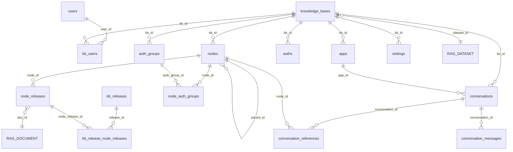

# PandaWiki 服务端数据库设计

本文档梳理 PostgreSQL 业务库中的主要表、字段含义与表间关系。Schema 由 `backend/store/pg/migration/*.sql`（golang-migrate）演进；ORM 模型在 `backend/domain`。

**重要约定：业务表之间基本没有数据库级 FOREIGN KEY，关联靠应用层逻辑外键（如 `kb_id`、`node_id`）保证。**

---

## 1. 总览

| 项 | 说明 |
|----|------|
| 数据库 | PostgreSQL（业务库 `panda-wiki`） |
| Schema 迁移 | `store/pg/migration`，版本记在 `schema_migrations` |
| 业务数据迁移 | `cmd/migrate` → 表 `migrations` |
| 旁路库 | 启动时可能创建 `raglite`（给 RAG 侧用，**不在本业务表清单内**） |

### 1.1 核心关系鸟瞰



### 1.2 两套「用户」不要混

| 表 | 含义 | 典型场景 |
|----|------|----------|
| `users` | 管理后台账号 | JWT 登录、KB 成员、发布人 |
| `auths` | 前台/企业认证访客 | Share 登录、评论归因、统计 `user_id`、投稿 |

会话 `info`、评论 `info` 里的 `auth_user_id` 指向 `auths.id`，不是 `users.id`。

---

## 2. 按业务域的表说明

### 2.1 用户与后台权限

#### `users`

控制台账号。

| 字段 | 说明 |
|------|------|
| `id` | PK（text） |
| `account` | 唯一账号 |
| `password` | 哈希密码 |
| `role` | `admin` / `user` 等 |
| `created_at` / `last_access` | 时间 |

#### `kb_users`

用户 ↔ 知识库多对多权限。

| 字段 | 说明 |
|------|------|
| `kb_id` + `user_id` | 逻辑唯一 |
| `perm` | 如 `full_control` / `doc_manage` / `data_operate` |

#### `api_tokens`

知识库级 API Token（Bearer 无 `.` 时走此表）。

| 字段 | 说明 |
|------|------|
| `kb_id` / `user_id` | 归属 |
| `token` | 唯一 |
| `permission` | Token 权限 |

---

### 2.2 知识库与前台访问

#### `knowledge_bases`（中心表）

| 字段 | 说明 |
|------|------|
| `id` | PK |
| `name` | 名称 |
| **`dataset_id`** | 外部 RAG **Dataset** ID（创建 KB 时写入） |
| `access_settings` | jsonb：端口/域名/BaseURL、SimpleAuth、EnterpriseAuth、是否 Forbidden 等 |

几乎所有业务表通过 `kb_id` 挂到此表下。

#### `auths`

前台访客身份（OAuth / 密码 / 机器人源等）。

| 字段 | 说明 |
|------|------|
| `id` | serial PK |
| `kb_id` | 所属知识库 |
| `union_id` / `source_type` | 外部身份 |
| `user_info` | jsonb |
| `last_login_time` | 最近登录 |

#### `auth_configs`

某 KB 下某认证源配置（`source_type` + `kb_id` 唯一），`auth_setting` jsonb。

#### `auth_groups`

认证用户分组（可树：`parent_id`；可同步企业通讯录）。

| 字段 | 说明 |
|------|------|
| `auth_ids` | `int[]`，逻辑指向 `auths.id` |
| `parent_id` / `position` | 树与排序 |
| `sync_id` 等 | 企业同步 |

#### `node_auth_groups`

节点 ↔ 认证组 ↔ 权限名（可见 / 可访问 / 可问答等）。

唯一维度：`(node_id, auth_group_id, perm)`。

---

### 2.3 文档节点与发布

这是编辑态与发布态分离的核心：

```text
nodes（草稿树）──发布──► node_releases（快照）
                              │
                              ├── RAG upsert → doc_id
                              └── kb_release_node_releases ← kb_releases（整库版本）
```

#### `nodes`

编辑态文档/目录树。

| 字段 | 说明 |
|------|------|
| `id` / `kb_id` | PK / 所属 KB |
| `type` | 目录 / 文档 |
| `status` | draft / released |
| `name` / `content` / `meta` | 内容与摘要等 |
| `parent_id` / `position` | 树结构 |
| `permissions` | jsonb：可见/可访问/可问答策略 |
| `rag_info` | jsonb：索引状态镜像 |
| `creator_id` / `editor_id` | → `users.id` |
| `doc_id` | **历史字段，已 DEPRECATED**（向量以 `node_releases.doc_id` 为准） |

#### `node_releases`

发布快照；**前台阅读与 RAG 索引以它为准**。

| 字段 | 说明 |
|------|------|
| `id` | 发布快照 ID |
| `kb_id` / `node_id` | 归属 |
| **`doc_id`** | 外部 RAG **Document** ID（Consumer upsert 回写） |
| `name` / `content` / `meta` | 发布时内容 |
| `parent_id` / `position` | 发布时树位置 |
| `publisher_id` / `editor_id` | → `users.id` |

#### `kb_releases`

整库发布版本（`tag` / `message` / `created_at`）。

#### `kb_release_node_releases`

KB 发布 ↔ 节点发布 的多对多：`release_id`、`node_release_id`（冗余 `kb_id`、`node_id`）。

#### `contributes`

前台投稿/修订审核：`auth_id`、`node_id`、`kb_id`、`status`、`type`（add/edit）、`audit_user_id` 等。

---

### 2.4 App / 机器人通道

#### `apps`

| 字段 | 说明 |
|------|------|
| `kb_id` + `type` | 唯一（一库一类通道一条） |
| `type` | Web / Widget / 钉钉 / 飞书 / 企微 / OpenAI API 等 |
| `settings` | jsonb：主题、机器人凭据、推荐问题、评论/反馈开关等 |

问答会话挂在 `apps` 上（`conversations.app_id`）。

---

### 2.5 会话与消息

#### `conversations`

| 字段 | 说明 |
|------|------|
| `id` / `nonce` | 会话 ID + 续聊校验 |
| `kb_id` / `app_id` | 归属 |
| `subject` | 首问摘要 |
| `info` | jsonb（含前台用户信息等） |
| `remote_ip` | 来源 IP |

#### `conversation_messages`

| 字段 | 说明 |
|------|------|
| `conversation_id` / `app_id` / `kb_id` | 归属 |
| `parent_id` | 问答配对（assistant 指向 user 消息） |
| `role` / `content` | user / assistant |
| `provider` / `model` | 模型信息 |
| token 字段 | 用量 |
| `info` | jsonb：赞踩 score、反馈类型与内容等 |

#### `conversation_references`

会话引用的文档（无独立 PK）：`conversation_id`、`node_id`、`name`、`url` 等。

---

### 2.6 模型与 KB 配置

#### `models`（全局，非按 KB）

每种 `type`（chat / embedding / rerank 等）全局配置语义；存 provider、base_url、api_key、parameters、累计 token 等。  
问答推理读 `type=chat`；向量化主体在外部 RAG，换 embedding 时可能重建 KB 的 `dataset_id`。

#### `settings`

KB 级 KV：`(kb_id, key)` 唯一，`value` jsonb。

| 已知 key | 用途 |
|----------|------|
| `system_prompt` | 问答 System Prompt（无独立 prompts 表） |
| `block_words` | 敏感词 |

---

### 2.7 评论、统计、反馈、许可

| 表 | 用途 |
|----|------|
| `comments` | 文档评论（`node_id`/`kb_id`，楼中楼 `parent_id`/`root_id`，审核 `status`，`pic_urls`） |
| `document_feedbacks` | 文档纠错反馈（migration 已建；主路径 GORM 使用较弱） |
| `stat_pages` | 页面访问明细（`scene`：欢迎/详情/聊天/登录；`user_id`→`auths`；`session_id`） |
| `stat_page_hours` | 按小时聚合（`kb_id`+`hour` 唯一；热门/地理等 jsonb） |
| `licenses` | License 存储（表已建；edition 亦可能由运行时注入） |

AI 消息反馈存在 `conversation_messages.info`，无独立 feedback 表。

---

### 2.8 迁移元数据

| 表 | 用途 |
|----|------|
| `schema_migrations` | golang-migrate 版本 |
| `migrations` | Go 业务迁移执行记录（`name` 唯一，`executed_at`） |

---

## 3. 表关系汇总

| 关系 | 类型 | 关联方式 |
|------|------|----------|
| users ↔ knowledge_bases | 多对多 | `kb_users` |
| knowledge_bases → nodes / apps / releases / auths / settings / stats… | 一对多 | `kb_id` |
| nodes 树 | 自引用 | `parent_id` |
| nodes → node_releases | 一对多 | `node_id` |
| kb_releases ↔ node_releases | 多对多 | `kb_release_node_releases` |
| auth_groups ↔ auths | 逻辑多对多 | `auth_groups.auth_ids[]` |
| nodes ↔ auth_groups | 多对多 + perm | `node_auth_groups` |
| apps → conversations → messages / references | 一对多链 | `app_id` / `conversation_id` |
| conversation_references → nodes | 多对一 | `node_id` |
| comments / contributes → nodes | 多对一 | `node_id` |

---

## 4. 与外部 RAG 的字段桥接

| PG 字段 | 外部实体 | 何时写入 | 何时使用 |
|---------|----------|----------|----------|
| `knowledge_bases.dataset_id` | RAG Dataset | 创建知识库 | 检索、上传/删除文档 |
| `node_releases.doc_id` | RAG Document | 发布后 Consumer upsert | 检索 chunk 回表节点、删旧文档 |
| `nodes.doc_id` | （历史） | 旧版本 | DEPRECATED |
| `nodes.rag_info` | 索引状态镜像 | 异步事件回写 | 管理端展示索引状态 |

发布 → 问答数据流：

```text
创建 KB → dataset_id
发布 Node → node_releases → MQ upsert → RAG Document → 回写 doc_id
问答 → RetrieveChunks(dataset) → DocumentID ≈ doc_id → 拼 Prompt → LLM
```

---

## 5. 全表速查

| 表名 | 业务域 | Domain 模型 | 备注 |
|------|--------|-------------|------|
| `users` | 后台用户 | `User` | |
| `kb_users` | 后台权限 | `KBUsers` | |
| `api_tokens` | API Token | `APIToken` | |
| `knowledge_bases` | 知识库 | `KnowledgeBase` | 含 `dataset_id` |
| `auths` | 前台身份 | `Auth` | |
| `auth_configs` | 认证配置 | `AuthConfig` | |
| `auth_groups` | 认证组 | `AuthGroup` | |
| `node_auth_groups` | 节点权限 | `NodeAuthGroup` | |
| `nodes` | 文档草稿 | `Node` | |
| `node_releases` | 发布快照 | `NodeRelease` | 主 `doc_id` |
| `kb_releases` | 整库发布 | `KBRelease` | |
| `kb_release_node_releases` | 发布关联 | `KBReleaseNodeRelease` | |
| `contributes` | 投稿审核 | `Contribute` | |
| `apps` | 应用通道 | `App` | |
| `conversations` | 会话 | `Conversation` | |
| `conversation_messages` | 消息 | `ConversationMessage` | 含反馈 jsonb |
| `conversation_references` | 引用 | `ConversationReference` | 无 PK |
| `models` | 全局模型 | `Model` | |
| `settings` | KB 配置 | `Setting` | Prompt/屏蔽词 |
| `comments` | 评论 | `Comment` | |
| `document_feedbacks` | 文档反馈 | （弱模型） | |
| `stat_pages` | 访问明细 | `StatPage` | |
| `stat_page_hours` | 小时聚合 | `StatPageHour` | |
| `licenses` | 许可 | （弱模型） | |
| `migrations` | 业务迁移 | `migration.Migration` | |
| `schema_migrations` | Schema 版本 | golang-migrate | |

---

## 6. 阅读与排查提示

1. **查前台看到的正文**：看 `node_releases`（及当前 `kb_releases` 映射），不要只看 `nodes`。  
2. **查问答为何无引用**：`dataset_id` 是否有效、`node_releases.doc_id` 是否已回写、Consumer 是否消费成功。  
3. **查权限**：后台看 `kb_users`；前台节点权限看 `nodes.permissions` + `node_auth_groups` + `auth_groups`。  
4. **删库/删节点**：无 DB 级联，需业务代码同时清 PG 与 RAG。  
5. **列与模型可能漂移**：以 migration 最终列为准；业务读写以 GORM 字段为准。  

Schema 演进入口：`backend/store/pg/migration/`。业务行为中的表用法可对照 [服务端请求调用链路](./服务端请求调用链路.md)、[前台问答流程](./前台问答流程.md)。

---

## 7. 一句话总结

业务库以 **`knowledge_bases` 为中心**，用 `kb_id` 挂文档树、应用、会话、认证与统计；**编辑用 `nodes`，阅读与向量用 `node_releases`**；通过 `dataset_id` / `doc_id` 桥接外部 RAG；后台 `users` 与前台 `auths` 两套身份并行，表间关联由应用层维护而非数据库外键。
