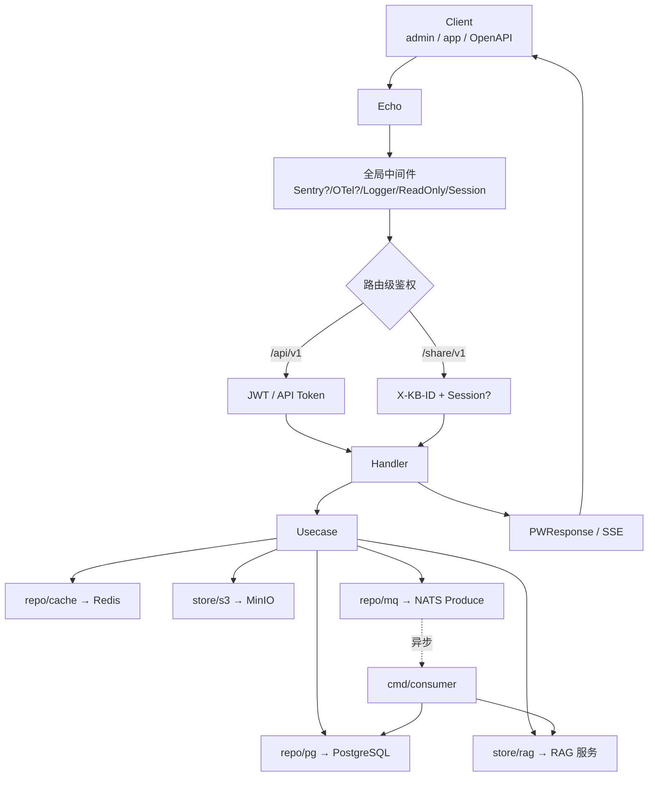
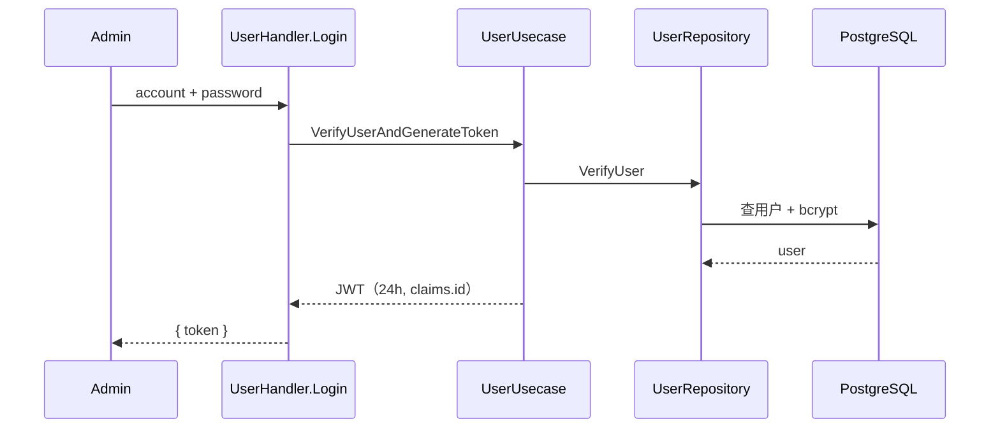
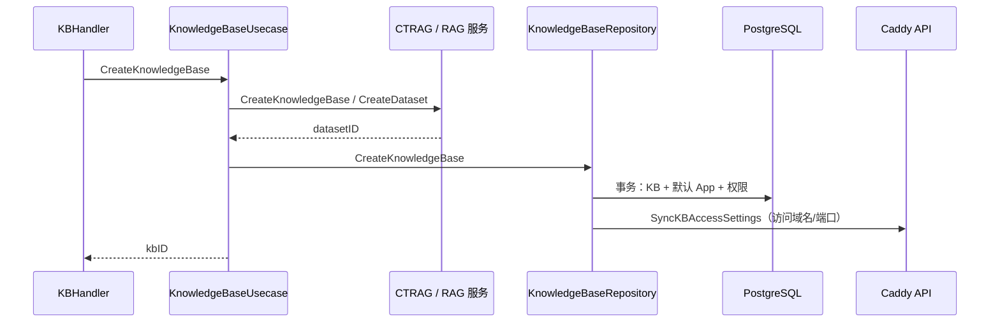
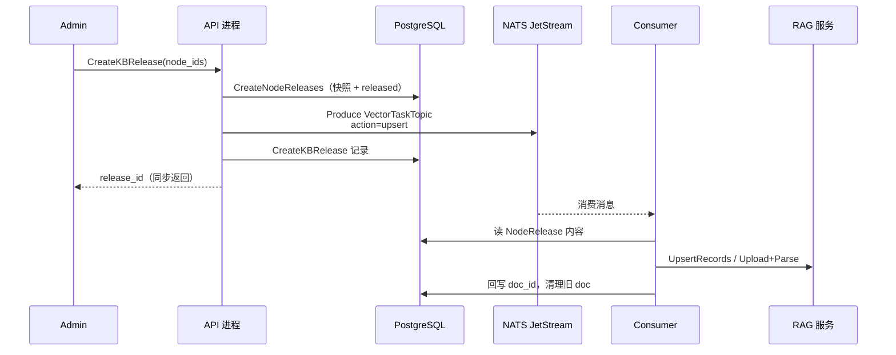
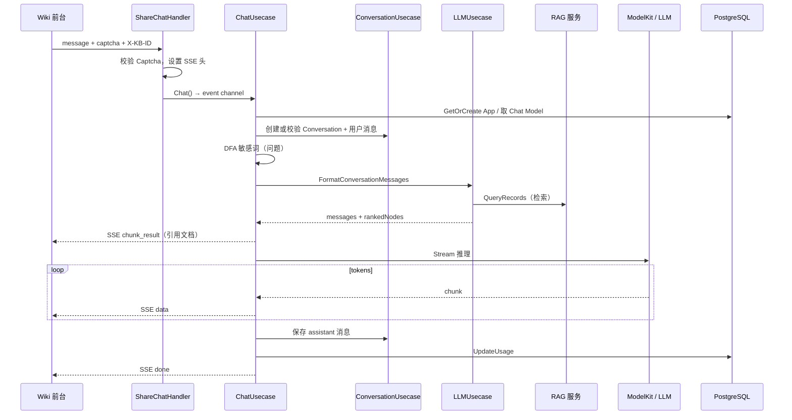

# PandaWiki 服务端请求调用链路

本文档描述 HTTP 请求进入 API 进程后，如何经过中间件、Handler、Usecase、Repo/Store，并在必要时经由 NATS 进入 Consumer，最终返回结果。重点覆盖登录、知识库、文档发布/向量化、Share 文档阅读与 AI 问答等核心链路。

## 1. 分层与通用路径

后端接近用例驱动分层，请求默认单向流动：

```text
HTTP Request
  → server/http（Echo 全局中间件）
  → middleware（路由级鉴权）
  → handler（协议适配：Bind / Validate / 响应）
  → usecase（业务编排）
  → repo（仓储）
  → store / mq / 外部服务（PG、Redis、S3、RAG、NATS、LLM）
  → handler 封装响应 → Client
```



| 层 | 目录 | 职责 |
|----|------|------|
| 传输入口 | `server/http`、`middleware`、`handler` | 路由、鉴权、参数校验、响应/SSE |
| 用例 | `usecase` | 编排事务边界外的业务流程 |
| 领域 | `domain` | DTO、实体、Topic、统一响应结构 |
| 仓储 | `repo/pg`、`repo/mq`、`repo/cache`、`repo/ipdb` | 持久化与消息投递 |
| 基础设施 | `store/*`、`mq`、`pkg` | DB/缓存/对象存储/RAG/第三方 SDK |

路由 **没有集中 Register**：Wire 构造各 `NewXxxHandler` 时，在构造函数内把路由挂到同一个 `*echo.Echo` 上。

---

## 2. 请求进入后的横切处理

### 2.1 全局中间件（所有请求）

装配：`server/http/http.go` → `NewEcho`

| 顺序 | 组件 | 说明 |
|------|------|------|
| 可选 | Sentry / OTel | 按配置启用 |
| 1 | RequestLogger | IP、方法、URI、状态、延迟 |
| 2 | `ReadOnlyMiddleware` | `READONLY=1` 时拦截多数写操作（登录等除外） |
| 3 | `SessionMiddleware` | Redis Session（Share 鉴权会用到） |

另有自定义 Binder（GET/DELETE 绑 Query，其它绑 Body）与 Validator。

### 2.2 路由级鉴权：V1 vs Share

| 维度 | V1 `/api/v1/*` | Share `/share/v1/*` |
|------|----------------|---------------------|
| 中间件 | `JWTMiddleware.Authorize`（+ Role / KB 权限） | `ShareAuthMiddleware.Authorize` / `CheckForbidden` |
| 凭证 | `Authorization: Bearer <JWT>` 或无 `.` 的 API Token | Header `X-KB-ID`（常由 Caddy 注入）+ 可选 Session |
| 身份含义 | 后台运营者 / Token 权限 | 某知识库的访客访问控制 |
| KB 上下文 | body/query 中的 `kb_id` | 固定来自 `X-KB-ID` |
| 典型调用方 | `web/admin` | `web/app`、挂件、部分 OpenAPI |

JWT 要点（`middleware/jwt.go`）：

- Bearer 含 `.` → 标准 JWT，解析 `id` 写入 `CtxAuthInfo`
- Bearer 不含 `.` → 走 API Token 仓储校验
- 可叠加 `ValidateUserRole`、`ValidateKBUserPerm`

Share 要点（`middleware/share_auth.go`）：

1. 必须有 `X-KB-ID`，并加载 KB（含 Redis 缓存）
2. `IsForbidden` → 403
3. 未开 Simple/Enterprise 认证 → 直接放行
4. 开启认证 → Session 中 `kb_id`（及企业认证 `user_id`）必须匹配

### 2.3 Handler 响应约定

`handler/base.go`：

- 成功：`NewResponseWithData` → HTTP 200 + `{ success: true, data }`
- 失败：`NewResponseWithError` → **仍多为 HTTP 200** + `{ success: false, message }`（带 trace_id）
- Share 聊天：走 SSE（`text/event-stream`），不走上述 JSON 封装

---

## 3. 核心链路一：用户登录

**接口**：`POST /api/v1/user/login`  
**鉴权**：无 JWT（仅过全局中间件）



| 步骤 | 模块 | 函数 |
|------|------|------|
| 1 | `handler/v1/user.go` | `Login` |
| 2 | `usecase/user.go` | `VerifyUserAndGenerateToken` |
| 3 | `repo/pg/user.go` | `VerifyUser` |
| 4 | — | 用 `JWT.Secret` 签发 HS256 Token |

前端将 token 存入 `localStorage.panda_wiki_token`，后续请求带 `Authorization`。

---

## 4. 核心链路二：创建知识库

**接口**：`POST /api/v1/knowledge_base`  
**鉴权**：JWT + `UserRoleAdmin`



要点：

- **先建 RAG Dataset，再落 PG**
- 会同步访问配置到 Caddy，供前台按 Host/端口路由到正确 KB
- **此链路不发向量 MQ**（尚无文档）

关键代码：`usecase/knowledge_base.go` → `CreateKnowledgeBase`；`repo/pg/knowledge_base.go`；`store/rag/ct`。

---

## 5. 核心链路三：文档编辑 vs 发布（向量化）

这是最容易误解的一点：**改草稿不会向量化；发布才会投递向量任务。**

### 5.1 更新草稿（同步，无 MQ）

**接口**：`PUT /api/v1/node/detail`  
**鉴权**：JWT + `DocManage`

```text
NodeHandler.UpdateNodeDetail
  → NodeUsecase.Update
  → NodeRepository.UpdateNodeContent
  → PG：更新内容，status=draft
```

### 5.2 发布知识库版本（同步写库 + 异步向量）

**接口**：`POST /api/v1/knowledge_base/release`  
**鉴权**：JWT + `DocManage`



Usecase 关键片段逻辑（`CreateKBRelease`）：

1. `nodeRepo.CreateNodeReleases` 生成发布快照  
2. 对每个 `releaseID` 组装 `NodeReleaseVectorRequest{Action:"upsert"}`  
3. `ragRepo.AsyncUpdateNodeReleaseVector` → NATS `apps.panda-wiki.vector.task`  
4. `repo.CreateKBRelease` 写入发布记录  

API **不等待**向量完成即返回。

### 5.3 Consumer 侧处理 upsert

进程：`cmd/consumer`  
注册：`handler/mq/rag.go` `NewRAGMQHandler` → `RegisterHandler(VectorTaskTopic, ...)`

`HandleNodeContentVectorRequest` 按 `action` 分支：

| Action | 行为 |
|--------|------|
| `upsert` | 读 NodeRelease → `rag.UpsertRecords` → 更新 `doc_id` → 删除旧 RAG 文档 |
| `delete` | `rag.DeleteRecords` |
| `summary` | LLM 摘要节点内容 |
| `update_group_ids` | 更新 RAG 文档权限组 |

另有 `rag.doc.update` Topic，由 `RagDocUpdateHandler` 回写节点 `rag_info` 状态。

### 5.4 其它会触发向量任务的入口

| 场景 | 大致入口 | Action |
|------|----------|--------|
| 删除节点 | `POST /api/v1/node/action` | `delete` |
| 批量摘要 | `POST /api/v1/node/summary` | `summary` |
| 重新学习 | `POST /api/v1/node/restudy` | `upsert` |
| 节点权限组变更 | 权限相关接口 | `update_group_ids` |

生产统一走：`repo/mq/rag.go` → `MQProducer.Produce(domain.VectorTaskTopic, ...)`。

---

## 6. 核心链路四：Share 阅读已发布文档

**接口**：`GET /share/v1/node/detail`（列表为 `/list`）  
**鉴权**：`ShareAuthMiddleware.Authorize`  
**调用方**：Wiki 前台 SSR / 客户端

```text
ShareNodeHandler.GetNodeDetail
  → 从 Header 取 X-KB-ID、Query 取 id
  → NodeUsecase.GetNodeReleaseDetail(...)   # 读「已发布」快照，非草稿
  → BaseHandler.NewResponseWithData
```

与管理端差异：

- 管理端 `GET /api/v1/node/detail` 看的是编辑态节点  
- Share 侧读 **Release** 视图，并受 KB 访问认证与节点可见性约束  

前台 `web/app` 在 Middleware / Layout / Page 中多次调用 Share Node/App API，服务端链路相同，只是发起方是 Next RSC 或浏览器。

---

## 7. 核心链路五：AI 问答（Share Chat SSE）

**接口**：`POST /share/v1/chat/message`  
**鉴权**：`ShareAuth.Authorize` + Captcha  
**协议**：SSE（`text/event-stream`）

这是跨度最长的同步链路：鉴权 → 会话 → 敏感词 → RAG 检索 → LLM 流式 → 落库。



### 7.1 Handler 层

`handler/share/chat.go` `ChatMessage`：

1. Bind/Validate；`KBID` 强制来自 `X-KB-ID`  
2. 仅允许 `AppTypeWeb`  
3. Captcha 校验  
4. 写 SSE 响应头；从 Session 取企业用户 `user_id`（若有）  
5. `chatUsecase.Chat` 返回 channel，循环 `writeSSEEvent`  

同类接口：

- `/share/v1/chat/widget`：挂件，校验 Widget 开关  
- `/share/v1/chat/completions`：OpenAI 兼容  

### 7.2 Usecase 编排（`ChatUsecase.Chat`）

在 goroutine 中顺序执行：

| 步 | 行为 | 依赖 |
|----|------|------|
| 1 | 取/建 App（按 KB + AppType） | `appRepo` |
| 2 | 取推理模型 | `modelUsecase.GetChatModel` |
| 3 | 会话：新建或校验 nonce | `conversationUsecase` |
| 4 | 落库用户问题 | PG |
| 5 | 问题敏感词 DFA | `blockWordRepo` + `utils.DFA` |
| 6 | 解析权限组 groupIds | `AuthRepo` |
| 7 | 拼 Prompt + RAG 检索 | `LLMUsecase.FormatConversationMessages` |
| 8 | SSE 推送 `chunk_result` | 引用的节点信息 |
| 9 | ModelKit 流式生成；可选答案敏感词缓冲过滤 | `ChatWithAgent` |
| 10 | 落库 assistant、更新 Token 用量 | PG |
| 11 | 发送 `done` / `error` | — |

### 7.3 RAG 检索细节（问答时同步调用）

`LLMUsecase.FormatConversationMessages`：

1. 拉会话历史消息  
2. 取 KB 自定义 System Prompt（否则默认）  
3. `GetRankNodes` → `rag.QueryRecords(datasetIDs, question, groupIDs, ...)`  
4. 将召回片段格式化为 Documents，填入 User Prompt 模板  
5. 拼出最终 `[]*schema.Message` 交给 LLM  

注意：这里的 RAG 调用在 **API 进程内同步完成**，与发布时的 **异步向量化** 是两条路：

| 阶段 | 进程 | 方向 |
|------|------|------|
| 发布建索引 | Consumer | 文档 → RAG Dataset |
| 问答检索 | API | 问题 → RAG 检索 → 上下文 → LLM |

---

## 8. 核心链路六：文件上传（简版）

**接口**：`POST /api/v1/file/upload`（JWT）  
**Share**：`POST /share/v1/common/file/upload`（ShareAuth + 图片 + Captcha）

```text
FileHandler.Upload
  → FileUsecase.UploadFile
  → MinioClient.PutObject（key 形如 {kbID}/{uuid}{ext}）
  → 返回可访问路径
```

`upload/anydoc`：供内网爬虫/转换服务回调，用来源 IP 校验而非 JWT。

---

## 9. 模块协作速查

### 9.1 一次「管理端写操作」典型栈

```text
Echo 全局中间件
  → JWT.Authorize [→ ValidateKBUserPerm]
  → handler/v1.XxxHandler
  → usecase.XxxUsecase
  → repo/pg（事务）
  → [可选] repo/mq.Produce
  → [可选] store/rag 或 store/s3（同步）
  → NewResponseWithData
```

### 9.2 一次「前台读文档」典型栈

```text
Echo 全局中间件（含 Session）
  → ShareAuth.Authorize（X-KB-ID + 可选 Session）
  → handler/share.ShareNodeHandler
  → NodeUsecase（Release 查询）
  → repo/pg
  → NewResponseWithData
```

### 9.3 一次「前台问答」典型栈

```text
ShareAuth + Captcha
  → ShareChatHandler（SSE）
  → ChatUsecase（goroutine + channel）
  → App/Model/Conversation/BlockWord/Auth Repos
  → LLMUsecase → RAG QueryRecords + Prompt
  → ModelKit Stream → SSE data
  → 落库 + done
```

### 9.4 一次「发布建索引」跨进程栈

```text
API: CreateKBRelease → PG NodeRelease → NATS Produce
Consumer: RAGMQHandler → RAG UpsertRecords → PG 回写 doc_id
（可选）RAG 回调/消息 → RagDocUpdateHandler → 更新 rag_info
```

---

## 10. 排查建议（按链路定位）

| 现象 | 优先查看 |
|------|----------|
| 401 Unauthorized（管理端） | JWT Secret、Token 是否过期、`Authorize` |
| 401/403（前台） | `X-KB-ID`、KB Forbidden、Session 与认证开关 |
| 发布成功但搜不到 / 答非所问 | Consumer 是否在跑；NATS stream；`RAGMQHandler` 日志；节点是否 folder |
| 聊天无回答 / 提示未配模型 | `ModelUsecase.GetChatModel`；管理台模型配置 |
| 聊天无引用文档 | 是否已发布并完成 upsert；`QueryRecords` / DatasetID |
| 上传失败 | MinIO 配置与 Bucket |
| 只读环境无法写入 | `READONLY` 环境变量 |

---

## 11. 关键源码索引

| 主题 | 路径 |
|------|------|
| Echo 全局中间件 | `backend/server/http/http.go` |
| JWT / API Token | `backend/middleware/jwt.go`、`auth.go` |
| Share 鉴权 | `backend/middleware/share_auth.go` |
| 响应基类 | `backend/handler/base.go` |
| 登录 | `backend/handler/v1/user.go`、`usecase/user.go` |
| 知识库 / 发布 | `backend/handler/v1/knowledge_base.go`、`usecase/knowledge_base.go` |
| 节点 | `backend/handler/v1/node.go`、`usecase/node.go` |
| Share 节点 | `backend/handler/share/node.go` |
| Share 聊天 | `backend/handler/share/chat.go`、`usecase/chat.go`、`usecase/llm.go` |
| MQ 生产 | `backend/repo/mq/rag.go`、`mq/nats/producer.go` |
| MQ 消费 | `backend/handler/mq/rag.go`、`cmd/consumer` |
| RAG 适配 | `backend/store/rag/` |
| API 文档 | `backend/docs/swagger.yaml` |

---

## 12. 一句话总结

请求先过 Echo 全局中间件，再按路径走 **JWT（管理端）** 或 **X-KB-ID/Session（Share）**；Handler 只做协议层，业务在 Usecase；持久化走 `repo/pg`，对象存储走 S3，检索/索引走 RAG。  
**写草稿同步落库；发布通过 NATS 交给 Consumer 建向量；问答在 API 进程内同步检索 + 流式调用 LLM，经 SSE 推回客户端。**
