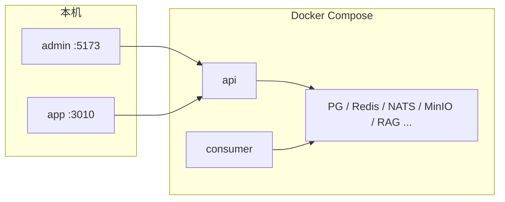

# PandaWiki 本地开发启动指南

> **分支说明**：本文按仓库 **`test` 分支**（「无线一点通」定制：落地页、互联网检索 Tab 等）编写。  
> 若在 `main`/上游开源分支，可能没有落地页「互联网检索」与 `NEXT_PUBLIC_WEB_SEARCH_URL`。

推荐方式：**Docker Compose 跑后端全家桶（含依赖），本机 pnpm 跑前端**。  
改 `backend` 时不要本机 `go run` 去装齐中间件，而是 **重建 API / Consumer 镜像并替换容器**。

---

## 1. 环境准备

| 工具 | 建议版本 | 用途 |
|------|----------|------|
| Docker / Compose | 20.x+ | 后端与全部依赖 |
| Go | 1.24+ | 仅用于构建后端镜像（及可选 `make generate`） |
| Node.js | 20.x | 前端 |
| pnpm | 10.x | 前端 monorepo |

```bash
git clone <仓库地址> PandaWiki
cd PandaWiki
git checkout test
```

---

## 2. 架构与分工



| 改动范围 | 怎么做 |
|----------|--------|
| 只改前端 | Compose 保持运行 → `pnpm dev` |
| 改 backend | Compose 保持依赖 → **rebuild 镜像** → `docker compose up -d api consumer` |
| 改 Wire / Swagger | 先 `cd backend && make generate`，再 rebuild |

本仓库的 `make dev` 依赖 `backend/deploy/`，开源树里可能没有该目录，**请用官方 compose**（下一节）。

---

## 3. 第一次：用官方 Compose 起后端

单独建运行时目录（可与源码分离）：

```bash
mkdir -p ~/panda-wiki-runtime && cd ~/panda-wiki-runtime
mkdir -p data/{caddy/{caddy_config,caddy_data,run},conf/api,minio,nats,nginx/ssl,postgres,qdrant,raglite}

# macOS 一般用 curl（无 wget 也不影响）
curl -fsSL -o docker-compose.yml \
  "https://release.baizhi.cloud/panda-wiki/docker-compose.yml"
```

在**同一目录**创建 `.env`（与 `docker-compose.yml` 并列，例如 `~/panda-wiki-runtime/.env`），密码自行替换，建议长度 > 8：

```bash
# 仍在 ~/panda-wiki-runtime 下
cat > .env <<'EOF'
TIMEZONE=Asia/Shanghai
SUBNET_PREFIX=169.254.15

POSTGRES_PASSWORD=changeme_pg
NATS_PASSWORD=changeme_nats
JWT_SECRET=changeme_jwt_secret
S3_SECRET_KEY=changeme_s3
REDIS_PASSWORD=changeme_redis
QDRANT_API_KEY=changeme_qdrant

ADMIN_PASSWORD=admin123456
ADMIN_PORT=2443
EOF
```

目录结构应类似：

```text
~/panda-wiki-runtime/
├── docker-compose.yml
├── .env
└── data/
    ├── postgres/
    ├── minio/
    └── ...
```

```bash
docker compose up -d
docker compose ps
```

**纯 Docker 访问入口（compose 已含 nginx / app / caddy）：**

| 地址 | 说明 |
|------|------|
| `https://127.0.0.1:2443` | **管理台**（`ADMIN_PORT`，nginx 镜像；自签证书选继续访问） |
| 创建知识库时配置的 Host + `ports` / `ssl_ports` | **Wiki 前台**（经 **Caddy `network_mode: host`** 对外监听；**没有固定成 3010**） |

- 账号：`admin` / `ADMIN_PASSWORD`
- `panda-wiki-app` 容器**一般不直接映射宿主机端口**；用户访问前台走的是 Caddy，按知识库 `access_settings` 里配的端口（常见如 `80`/`443`，或你自填的端口）反代到 app
- API 多为内网网段通信；本机改前端时再单独映射/直连 `8000`（以你 compose 为准）

登录后：

1. 配置 Chat / Embedding / Rerank 模型  
2. 创建知识库，填好访问域名/IP 与端口，**复制知识库 ID**（本机 `pnpm` 前台的 `DEV_KB_ID` 要用）

---

## 4. 本机启动前端（改 UI 时用；端口不是 Docker 的）

```bash
cd web
pnpm install
```

### 4.1 管理台 `web/admin/.env.local`

本机 `pnpm` 开发时，**推荐直连 api:8000**（避免 Next SSR 访问 nginx `https://2443` 自签证书导致 `fetch failed`）。  
先在 `docker-compose.yml` 的 `api` 服务加端口映射：

```yaml
ports:
  - "8000:8000"
```

然后 `docker compose up -d api`。

```env
TARGET=http://127.0.0.1:8000
SHARE_TARGET=http://127.0.0.1:8000
STATIC_FILE_TARGET=https://127.0.0.1:2443
```

### 4.2 前台 `web/app/.env.local`

仓库另有 `web/app/.env.dev`（含示例 `DEV_KB_ID`、互联网检索 URL）。本地联调以 **`.env.local` 为准**（优先级更高，且勿提交密钥）。

```env
TARGET=http://127.0.0.1:8000
STATIC_FILE_TARGET=https://127.0.0.1:2443
DEV_KB_ID=xxxxxxxx-xxxx-xxxx-xxxx-xxxxxxxxxxxx

# test 分支：互联网检索 iframe 地址（可与 .env.dev / .env.production 保持一致）
NEXT_PUBLIC_WEB_SEARCH_URL=https://llm.webinfra.cloud/c/new?endpoint=Deepseek&model=deepseek-chat&sidebar=hidden&navbar=hidden
```

> `DEV_KB_ID` 必须是管理台创建知识库后的**真实 ID**（纯 ASCII）。不要写成中文占位；未建库/未填写时前台会 404 或拉不到配置。  
> 不要用 `TARGET=https://127.0.0.1:2443` 给 Next 服务端用——Node 默认校验证书，自签会报 `fetch failed`（除非设 `NODE_TLS_REJECT_UNAUTHORIZED=0`，不推荐）。  
> 不要用容器内主机名写进前端 env。改完 `.env.local` / compose 后需重启 `pnpm dev`。  
> **`cid` 是会话 ID，不是知识库 ID**，不能填进 `DEV_KB_ID`。

#### 落地页两个按钮（test 分支）

| 按钮 | 行为 | 模型 / Key 在哪 |
|------|------|-----------------|
| **AI智能问答** | 打开 QaModal → `mode=chat` → 调本机 API `/share/v1/chat/message` | 管理台「系统配置 → 模型」的智能对话模型 |
| **互联网检索** | 打开 QaModal → `mode=web-search` → **iframe** 加载 `NEXT_PUBLIC_WEB_SEARCH_URL` | **外部** `llm.webinfra.cloud`（Deepseek 等），**不在** PandaWiki 模型配置里 |

本地可访问：`http://127.0.0.1:3010/landing`（落地页）或带 `DEV_KB_ID` 后的站点首页。

### 4.3 启动

```bash
cd web
pnpm dev                    # 同时起 admin + app
# 或分开：
# pnpm --filter panda-wiki-admin dev   # http://127.0.0.1:5173
# pnpm --filter panda-wiki-app dev     # http://127.0.0.1:3010
```

| 地址 | 说明 |
|------|------|
| `http://127.0.0.1:5173` | **本机 Vite 管理台**（不是 Docker 的 2443） |
| `http://127.0.0.1:3010` | **本机 Next 前台**（不是 Caddy 对外端口） |

对照：

| 场景 | 管理台 | Wiki 前台 |
|------|--------|-----------|
| 只用官方 Compose 镜像 | `https://127.0.0.1:2443` | 知识库里配置的端口（Caddy） |
| Compose 后端 + 本机 `pnpm dev` | `http://127.0.0.1:5173` | `http://127.0.0.1:3010` |

开发时通常用第二行热更新；验收「和客户一样的整包」时用第一行。

---

## 5. 改 backend 之后怎么启动（推荐）

依赖继续跑在 Compose 里；只重新构建并替换业务容器。

```bash
cd /path/to/PandaWiki/backend

# 若改了依赖注入 / 路由注解
# make generate

COMMIT_HASH=$(git rev-parse --short HEAD)
LOCAL_PLATFORM=linux/$(uname -m)

# 改了 API 相关代码
make image PLATFORM=${LOCAL_PLATFORM} DOCKERFILE=Dockerfile.api \
  IMAGE_NAME=chaitin-registry.cn-hangzhou.cr.aliyuncs.com/chaitin/panda-wiki-api:latest \
  OUTPUT=type=docker VERSION=${COMMIT_HASH}

# 仅当改了 MQ 消费 / 定时任务等再构建
make image PLATFORM=${LOCAL_PLATFORM} DOCKERFILE=Dockerfile.consumer \
  IMAGE_NAME=chaitin-registry.cn-hangzhou.cr.aliyuncs.com/chaitin/panda-wiki-consumer:latest \
  OUTPUT=type=docker VERSION=${COMMIT_HASH}

cd ~/panda-wiki-runtime
docker compose up -d api consumer
docker compose logs -f api
```

要点：

- 镜像名需与 compose 中 `api` / `consumer` 的 `image` 一致（上面为官方常用名；若你的 yml 不同，改 `IMAGE_NAME` 或改 compose）
- 只改 API → 只 rebuild `Dockerfile.api`，更快
- 前端 `pnpm` 进程一般不用重启

**不推荐**本机 `go run ./cmd/api`：要自己对齐 PG/Redis/NATS/MinIO/RAG，且代码里写死了 `/app`、`/data`、`file://migration` 等路径，联调成本高。

---

## 6. 日常联调顺序

```text
1. cd ~/panda-wiki-runtime && docker compose up -d
2. 控制台配模型、建 KB（首次）
3. 配好 web/admin、web/app 的 .env.local
4. cd web && pnpm dev
5. 改 frontend → 热更新
6. 改 backend → make image → compose up -d api [consumer]
7. 发布文档验证问答时，看 consumer 日志是否正常
```

---

## 7. 常用命令

```bash
# Compose（runtime 目录）
docker compose ps
docker compose logs -f api consumer
docker compose restart api
docker compose down

# 前端（web 目录）
pnpm install
pnpm dev
pnpm --filter panda-wiki-admin dev
pnpm --filter panda-wiki-app dev

# 后端（backend 目录）
make generate
# make image ... 见 §5
```

---

## 8. 常见问题

| 现象 | 处理 |
|------|------|
| 前端连不上 API | `TARGET`、compose 端口映射、`docker compose ps` |
| 前台 401 / 无 KB | 检查 `DEV_KB_ID` |
| 发布后问答无引用 | `consumer` / NATS / RAG 是否正常 |
| 未配置模型 | 控制台配置 Chat（及 Embedding、Rerank） |
| 登录失败 | `.env` 的 `ADMIN_PASSWORD` |
| rebuild 后仍是旧代码 | 确认 `IMAGE_NAME` 与 compose 一致，且 `up -d` 已拉起新镜像 |
| pnpm 报错 | 必须用 pnpm，不要用 npm/yarn |
| HTTPS 警告 | 自签证书，浏览器继续访问即可 |
| 互联网检索 402 / Insufficient Balance | 到 **llm.webinfra.cloud / Deepseek** 侧查余额与 Key，不是改管理台「智能对话模型」 |
| iframe 空白 / 加载失败 | 检查 `NEXT_PUBLIC_WEB_SEARCH_URL`、本机能否访问该 URL、浏览器跨域/混合内容 |

---

## 9. 相关文档

- [服务端启动流程](./服务端启动流程.md) · [前端启动流程](./前端启动流程.md)  
- [服务端请求调用链路](./服务端请求调用链路.md) · [前台问答流程](./前台问答流程.md)  
- [服务端数据库设计](./服务端数据库设计.md)

---

**一句话**：Compose 管后端与依赖，pnpm 管前端；改 Go 就 rebuild 镜像替换 `api`/`consumer`，别为本机启动去装一整套中间件。
