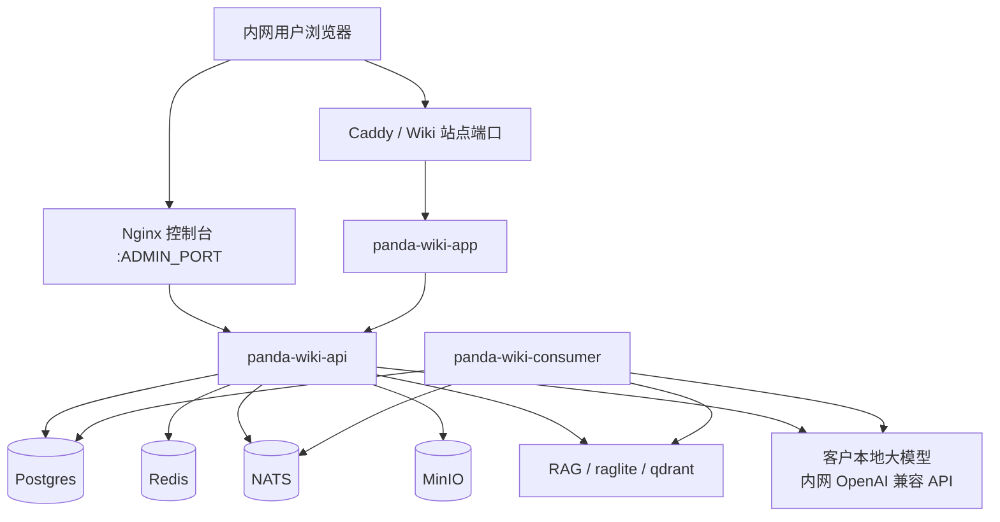

# PandaWiki 生产环境部署指南（内网 + 本地大模型）

> **分支说明**：自研交付以仓库 **`test` 分支**为准（含「无线一点通」落地页、互联网检索 iframe 等）。构建前端前请 `git checkout test`。

适用场景：

- 部署在**客户内网**服务器，外网不可达或受限  
- 大模型由客户**自建**（如 Ollama、vLLM、OneAPI、本地 OpenAI 兼容网关等）  
- 交付方需要做：**第一次完整上线**，以及**改功能后的增量发布**

推荐形态与官方一致：**Docker Compose 一键编排**；业务镜像（api / consumer，必要时前端）在可联网构建机打好，再离线导入客户机。

---

## 0. 总体架构（生产）



| 组件 | 作用 |
|------|------|
| api | 业务 HTTP；镜像内含 migrate，启动时先迁移再起服务 |
| consumer | 发布后向量化、定时任务等 |
| app / nginx / caddy | Wiki 前台与控制台入口、反向代理、证书 |
| postgres / redis / nats / minio | 数据、缓存、消息、对象存储 |
| rag / raglite / qdrant 等 | 检索与向量相关 |
| crawler | 网页/离线文件等导入解析（不用导入也可先保留） |
| **客户本地 LLM** | 不在本 compose 内；需保证 **api/consumer 容器能访问其内网地址** |

---

## 第一部分：第一次部署

### 1.1 环境要求（客户机）

| 项 | 建议 |
|----|------|
| 系统 | Linux x86_64（常见 CentOS 7+/Ubuntu 20.04+）；若为 ARM 需对应镜像 |
| Docker | 20.x+，已安装 Compose 插件（`docker compose version`） |
| 资源 | 建议 ≥ 4 核 / 8GB 内存 / 50GB+ 磁盘（文档与向量会占盘） |
| 网络 | 内网互通；**客户机无需访问公网**（若已离线导入全部镜像） |
| 本地大模型 | 已提供 OpenAI 兼容 HTTP 接口（至少 Chat；问答/检索通常还要 Embedding，视部署方案可能还要 Rerank） |

提前向客户确认：

1. 控制台访问地址/端口（如 `https://10.x.x.x:2443`）  
2. Wiki 站点域名或 IP + 端口  
3. 本地大模型 Base URL（容器内访问地址，见 §1.6）  
4. 模型名称（chat / embedding / rerank 各自叫什么）

### 1.2 准备安装包（可联网构建机上完成）

在能访问镜像仓库与发布站的机器上准备「离线包」，再拷到客户内网。

#### （1）运行时文件

```bash
mkdir -p panda-wiki-prod/{data,images}
cd panda-wiki-prod
mkdir -p data/{caddy/{caddy_config,caddy_data,run},conf/api,minio,nats,nginx/ssl,postgres,qdrant,raglite}

curl -fsSL -o docker-compose.yml \
  "https://release.baizhi.cloud/panda-wiki/docker-compose.yml"
```

编写 `.env`（**生产务必改强密码**）：

```env
TIMEZONE=Asia/Shanghai
SUBNET_PREFIX=169.254.15

POSTGRES_PASSWORD=<强密码>
NATS_PASSWORD=<强密码>
JWT_SECRET=<随机长串>
S3_SECRET_KEY=<强密码>
REDIS_PASSWORD=<强密码>
QDRANT_API_KEY=<强密码>

ADMIN_PASSWORD=<管理员初始密码>
ADMIN_PORT=2443
```

#### （2）拉取并导出镜像

根据 `docker-compose.yml` 中的 `image:` 列表，在构建机执行例如：

```bash
docker compose pull
# 或按 yml 中镜像名逐个 docker pull

docker compose config --images | sort -u > images.txt
# 将 images.txt 中镜像 save 成包，示例：
mkdir -p images
while read img; do
  safe=$(echo "$img" | tr '/:' '__')
  docker save "$img" | gzip > "images/${safe}.tar.gz"
done < images.txt
```

若交付的是**自研修改版**，还需在源码机构建并一并导出：

```bash
# 在源码 backend 目录
COMMIT_HASH=$(git rev-parse --short HEAD)
PLATFORM=linux/amd64   # 与客户 CPU 架构一致

make image PLATFORM=${PLATFORM} DOCKERFILE=Dockerfile.api \
  IMAGE_NAME=chaitin-registry.cn-hangzhou.cr.aliyuncs.com/chaitin/panda-wiki-api:<版本号> \
  OUTPUT=type=docker VERSION=${COMMIT_HASH}

make image PLATFORM=${PLATFORM} DOCKERFILE=Dockerfile.consumer \
  IMAGE_NAME=chaitin-registry.cn-hangzhou.cr.aliyuncs.com/chaitin/panda-wiki-consumer:<版本号> \
  OUTPUT=type=docker VERSION=${COMMIT_HASH}

# 导出离线包（镜像名须与上面 IMAGE_NAME 完全一致；版本号自行替换）
VERSION=v1.0.0   # 示例，与 <版本号> 相同
mkdir -p ../panda-wiki-prod/images
docker save \
  chaitin-registry.cn-hangzhou.cr.aliyuncs.com/chaitin/panda-wiki-api:${VERSION} \
  chaitin-registry.cn-hangzhou.cr.aliyuncs.com/chaitin/panda-wiki-consumer:${VERSION} \
  | gzip > ../panda-wiki-prod/images/panda-wiki-backend-${VERSION}.tar.gz
```

前端若也改过：分别在 `web/admin`、`web/app` 构建并打镜像后，替换 compose 中对应 image（官方服务名一般为 `nginx`←管理台、`app`←Wiki 前台）。

**前端打生产镜像时的 env（与本地 `pnpm` 开发不同）：**

以 `test` 分支仓库内文件为准：`web/app/.env.production`（构建时由 Next 加载）。

| 应用 | 构建时需要的 env | 说明 |
|------|------------------|------|
| **管理台 admin** | 一般**不需要** `TARGET` / `SHARE_TARGET` | 生产是静态资源 + nginx 反代；浏览器请求相对路径 `/api`、`/share`，由镜像内 `server.conf` 转到 `panda-wiki-api:8000`。本地 `.env.local` **不要**带进生产构建。可选：`web/admin/.env.production` 写 `VITE_APP_VERSION=x.y.z`（仅展示版本号）。 |
| **Wiki 前台 app** | **需要** `TARGET=http://panda-wiki-api:8000` | 已在 `web/app/.env.production`；构建前确认 `.env.local` 未覆盖成 `127.0.0.1`（可先移走 `.env.local`）。 |
| Wiki 前台 app | **需要** `NEXT_PUBLIC_WEB_SEARCH_URL=...` | **test 分支互联网检索**：打进浏览器端的 iframe 地址。仓库默认指向 `https://llm.webinfra.cloud/c/new?endpoint=Deepseek&model=deepseek-chat&sidebar=hidden&navbar=hidden`。纯内网客户若访问不到该域名，须改成客户可达的网关后再 build。 |
| Wiki 前台 app | **不要**配 `DEV_KB_ID` | 生产由 Caddy 按访问 Host 注入 `x-kb-id`；`DEV_KB_ID` 仅本地开发。 |
| Wiki 前台 app | `STATIC_FILE_TARGET` | 勿把本机开发用的 `https://127.0.0.1:2443` 打进生产包。 |

**注意区分两套「模型」：**

| 能力 | 配置位置 |
|------|----------|
| 落地页「AI智能问答」/ 知识库 RAG 问答 | 管理台 **系统配置 → 模型**（Chat / Embedding / Rerank） |
| 落地页「互联网检索」 | **外部** `NEXT_PUBLIC_WEB_SEARCH_URL` 指向的服务（如 llm.webinfra.cloud + Deepseek），Key/余额不在 PandaWiki 模型页 |

示例（自研前端镜像，`test` 分支 Makefile 默认名）：

```bash
git checkout test
cd web
pnpm install

# 构建前建议移走 web/app/.env.local，避免盖掉 .env.production
# 确认 web/app/.env.production 中 TARGET 与 NEXT_PUBLIC_WEB_SEARCH_URL 正确

# 管理台 → 镜像名 panda-wiki-admin/frontend:<TAG>（与客户 compose 中 nginx 的 image 对齐，必要时 docker tag）
cd admin && make image PLATFORM=linux/amd64 TAG=<版本号>
# 默认产出：panda-wiki-admin/frontend:<版本号>

# 前台 → panda-wiki-app/frontend:<TAG>
cd ../app && make image PLATFORM=linux/amd64 TAG=<版本号>
# 默认产出：panda-wiki-app/frontend:<版本号>
# make save 写死了 :main，改 TAG 后请自行：
# docker save panda-wiki-app/frontend:<版本号> | gzip > panda-wiki-app-<版本号>.tar.gz
```

> 客户机 compose 根目录的 `.env`（`POSTGRES_PASSWORD`、`ADMIN_PORT` 等）是**运行时**给容器用的，**不是**前端 `pnpm build` 时要填的那套；两套不要混。  
> 现网若已使用 `panda-wiki-app/frontend:main` / `panda-wiki-admin/frontend:main`，升级时保持同名 tag 或同步改 compose 的 `image:`。

#### （3）打包拷贝到客户机

```text
panda-wiki-prod/
├── docker-compose.yml
├── .env
├── images/*.tar.gz
├── images.txt          # 可选，清单
└── data/               # 空目录结构即可
```

用 U 盘 / 内网文件服务器拷到客户机，例如 `/opt/panda-wiki`。

### 1.3 客户机导入并启动

```bash
cd /opt/panda-wiki

# 导入全部镜像
for f in images/*.tar.gz; do
  gunzip -c "$f" | docker load
done

# 启动
docker compose up -d
docker compose ps
docker compose logs -f api   # 确认 migrate + api 无报错后 Ctrl+C
```

检查要点：

- 所有关键容器 `Up`  
- `api` 日志无数据库/NATS/RAG 连接失败  
- 浏览器访问 `https://<客户机IP>:${ADMIN_PORT}`（自签证书需信任/继续访问）  
- 使用 `.env` 中 `ADMIN_PASSWORD` 以 `admin` 登录  

### 1.4 防火墙与内网访问

按客户安全规范放行（示例）：

| 端口 | 用途 |
|------|------|
| `ADMIN_PORT`（默认 2443） | 管理控制台 |
| 知识库站点 HTTP/HTTPS 端口 | 创建 KB 时在控制台配置，由 Caddy 监听 |
| 本地大模型端口 | **仅需 PandaWiki 主机 → 模型服务**，不必对全员开放 |

纯内网可不申请公网证书，继续用自签；若客户有内网 CA，可替换 `data/nginx/ssl` 等证书文件后重启相关容器（以实际 compose 挂载为准）。

### 1.5 配置本地大模型（关键）

首次登录后进入控制台 **系统设置 → 模型**，**不要走依赖公网百智云的一键 auto**（内网通常不可用）。改为**手动配置**：

| 类型 | 是否必需 | 说明 |
|------|----------|------|
| Chat | 必需 | AI 问答、部分摘要/创作 |
| Embedding | 强烈建议 | 文档向量化 / 检索；缺失会导致发布索引或问答检索异常 |
| Rerank | 视方案 | 有则配置，提升检索排序；部分本地栈可暂缺（以实际报错为准） |

配置项一般包括：

- **Provider**：选兼容 OpenAI 的类型（界面选项以版本为准，常见为 OpenAI / 自定义等）  
- **Base URL**：客户模型网关地址（见下）  
- **API Key**：本地服务若无鉴权可填占位；有鉴权则填真实 Key  
- **Model**：本地实际模型名（如 `qwen2.5-7b-instruct`、`bge-m3`）

#### Base URL 怎么填（容器访问视角）

API 跑在 Docker 网络内，`127.0.0.1` **不是**宿主机。

| 模型部署位置 | Base URL 示例 |
|--------------|----------------|
| 与 PandaWiki 同一台宿主机 | `http://172.17.0.1:<端口>/v1` 或 compose 增加 `extra_hosts: - "host.docker.internal:host-gateway"` 后用 `http://host.docker.internal:<端口>/v1` |
| 内网另一台机器 | `http://10.x.x.x:<端口>/v1` |
| 已有统一网关 | `http://llm-gateway.internal/v1` |

配置后在控制台做「连通性检测 / 保存」；再创建知识库、导入或编写文档并**发布**，用 Wiki 前台试一次问答。

### 1.6 创建知识库与验收清单

1. 创建知识库，配置访问 Host/端口（内网 IP 或域名）  
2. 录入或导入若干文档 → **发布**  
3. 看 `docker compose logs consumer`，确认向量任务成功  
4. 打开 Wiki 站点 / 落地页，验证阅读与 **AI智能问答**  
5. （test 定制）验证 **互联网检索**：浏览器能打开 iframe 目标站；若客户内网不能访问 `llm.webinfra.cloud`，须先改 `NEXT_PUBLIC_WEB_SEARCH_URL` 并重打 app 镜像，或在内网部署等价服务  
6. 修改 `admin` 初始密码；备份 `.env` 与 `data/` 路径权限（仅运维可读写）

验收通过即完成第一次部署。

### 1.7 备份（上线后立刻做一次）

```bash
cd /opt/panda-wiki
docker compose exec -T postgres \
  pg_dump -U panda-wiki panda-wiki > backup-$(date +%F).sql
# 同时备份整个 data/ 目录（含 MinIO 文件、向量相关数据等）
tar -czf data-backup-$(date +%F).tar.gz data .env docker-compose.yml
```

定期备份策略由客户运维执行；升级前必须再备份。

---

## 第二部分：后续修改功能后的部署

原则：**尽量只替换变更相关的镜像，不动数据卷 `data/`，避免清库。**

### 2.1 发布前（构建机 / CI）

1. 合并代码，打版本号（如 `v1.2.3` 或 git tag）  
2. 按变更范围构建镜像：

| 变更内容 | 需要重新构建 |
|----------|----------------|
| 仅 backend API 逻辑 | `Dockerfile.api` |
| MQ 消费 / 定时任务 / 向量处理 | `Dockerfile.consumer`（常与 api 一起发） |
| 管理台 UI | admin 前端镜像（或官方 nginx 前端镜像替换约定） |
| Wiki 前台 | app 前端镜像 |
| 仅配置 / 文案且不在镜像内 | 可能只改 `.env` 或挂载配置 |

#### 如何判断「改了哪段代码 → 打哪个镜像」

仓库里后端其实是 **两个独立二进制**，各自打进不同镜像：

| 镜像 / Dockerfile | 编译入口 | 进程职责 |
|-------------------|----------|----------|
| `Dockerfile.api` | `cmd/api`（另含 `cmd/migrate`） | HTTP：管理端 `/api/v1/*`、前台分享 `/share/v1/*`；容器启动时先跑迁移 |
| `Dockerfile.consumer` | `cmd/consumer` | NATS 消费（向量化等）+ 定时任务（统计等） |

**按目录快速对照（最常用）：**

| 你改的路径 | 通常打哪个镜像 | 说明 |
|------------|----------------|------|
| `backend/handler/v1/**` | **仅 api** | 管理端 HTTP Handler |
| `backend/handler/share/**` | **仅 api** | 前台分享 / 问答 HTTP Handler |
| `backend/server/http/**`、`middleware/**`、`pkg/captcha/**` | **仅 api** | HTTP 服务与鉴权中间件 |
| `backend/handler/mq/**` | **仅 consumer** | MQ 回调、向量任务、Cron |
| `backend/store/pg/migration/**` | **api**（必打） | 迁移只在 api 容器启动命令里执行；consumer 虽拷了 migration 目录但**不会自动跑** |
| `backend/usecase/**`、`repo/**`、`domain/**`、`store/rag/**`、`mq/**`（非 handler） | **看场景，拿不准就两个都打** | 两边都可能依赖；见下方「共享代码」 |
| `web/admin/**` | admin 前端镜像 | 与 backend 镜像无关 |
| `web/app/**` | app 前端镜像 | 与 backend 镜像无关 |

**按功能现象对照：**

| 现象 / 功能 | 镜像 |
|-------------|------|
| 登录、建库、编辑文档、模型配置、发布接口报错或行为变了 | api |
| 前台问答 SSE、验证码、分享页接口 | api |
| 文档**已发布**但向量检索不到 / 问答引用不到新内容 | consumer（向量任务在 MQ 里做） |
| 统计定时汇总、后台异步任务不跑 | consumer |
| 表结构变更（新 migration） | api（并确认迁移日志成功） |

**共享代码怎么判（`usecase` / `repo` / `domain` 等）：**

1. 若改动只服务 HTTP 同步路径（例如改问答 Prompt 拼装、接口校验），一般 **只打 api**。  
2. 若改动影响「发布后写向量 / 更新文档 / Cron 统计」等异步路径，**打 consumer**；若 API 侧也走同一 usecase，**两个都打**。  
3. **拿不准时两个都打**——成本只是多一个镜像，比漏发 consumer 导致「接口正常但向量不更新」更安全。

**可用命令自查（改完某个包后）：**

在 `backend/` 下看依赖树里是否出现该包（有 Go 环境时）：

```bash
# 某包是否被 api 二进制用到
go list -deps ./cmd/api/ | grep 'panda-wiki/usecase'

# 是否被 consumer 用到
go list -deps ./cmd/consumer/ | grep 'panda-wiki/usecase'
```

或直接看 Wire 装配入口：

- api：`cmd/api/wire.go` → `handler/v1` + `handler/share`
- consumer：`cmd/consumer/wire.go` → `handler/mq`

改了 `handler/mq` 一定打 consumer；改了 `handler/v1` / `share` 一定打 api。

示例（backend）：

```bash
cd backend
VERSION=v1.2.3
PLATFORM=linux/amd64

make image PLATFORM=${PLATFORM} DOCKERFILE=Dockerfile.api \
  IMAGE_NAME=chaitin-registry.cn-hangzhou.cr.aliyuncs.com/chaitin/panda-wiki-api:${VERSION} \
  OUTPUT=type=docker VERSION=${VERSION}

make image PLATFORM=${PLATFORM} DOCKERFILE=Dockerfile.consumer \
  IMAGE_NAME=chaitin-registry.cn-hangzhou.cr.aliyuncs.com/chaitin/panda-wiki-consumer:${VERSION} \
  OUTPUT=type=docker VERSION=${VERSION}

docker save \
  chaitin-registry.cn-hangzhou.cr.aliyuncs.com/chaitin/panda-wiki-api:${VERSION} \
  chaitin-registry.cn-hangzhou.cr.aliyuncs.com/chaitin/panda-wiki-consumer:${VERSION} \
  | gzip > panda-wiki-backend-${VERSION}.tar.gz
```

3. 编写简短 **Release Note**（改了什么、是否有迁移、是否要重配模型）  
4. 将 `*.tar.gz` + 说明传到客户机  

若 `docker-compose.yml` 中写死了 `:latest`，构建时也可继续打 `latest` tag，但**生产更建议固定版本号**，升级时改 yml 或重新 tag。

### 2.2 客户机升级步骤

```bash
cd /opt/panda-wiki

# 1) 备份
docker compose exec -T postgres \
  pg_dump -U panda-wiki panda-wiki > backup-before-${VERSION}.sql
tar -czf data-backup-before-${VERSION}.tar.gz data .env docker-compose.yml

# 2) 导入新镜像
gunzip -c /path/to/panda-wiki-backend-${VERSION}.tar.gz | docker load

# 3) 若使用版本号 tag：编辑 docker-compose.yml 中 api/consumer 的 image 标签
#    若导入时已 tag 为 compose 正在使用的名字（如 :latest），可跳过改 yml

# 4) 滚动替换业务容器（不要 down -v）
docker compose up -d api consumer
# 若还有前端镜像更新：
# docker compose up -d nginx app   # 名称以实际 yml 为准

# 5) 看日志
docker compose logs -f api consumer
```

说明：

- `Dockerfile.api` 启动会先跑 **migrate**，一般会自动做 Schema / 业务迁移；观察 api 日志确认成功  
- **禁止**对生产执行 `docker compose down -v` 或删除 `data/`，否则数据丢失  
- 本地大模型地址未变则**无需重配**；若本次改了模型调用逻辑，按 Release Note 回归问答  

### 2.3 升级后回归

1. 管理台登录是否正常  
2. 打开已有知识库、文档是否还在  
3. 新建/编辑一篇文档并**发布**，consumer 无报错  
4. 前台问答是否仍走客户本地模型（可在模型服务侧看请求日志）  
5. 上传附件、导入（若本次改动相关）  

### 2.4 回滚

```bash
cd /opt/panda-wiki
# 重新 load 上一版本镜像，或改 compose 镜像 tag 为旧版本
docker compose up -d api consumer

# 仅当迁移造成不兼容且有库备份时，再考虑停服恢复 SQL（需评估迁移是否可逆）
# docker compose stop api consumer
# cat backup-before-xxx.sql | docker compose exec -T postgres psql -U panda-wiki panda-wiki
```

回滚前先保留故障现场日志：`docker compose logs --no-color > logs-fail.txt`。

### 2.5 建议的版本发布节奏

```text
开发机改代码
  → 构建机 make image + docker save
  → 内网传输 tar.gz
  → 客户机 docker load
  → 备份
  → compose up -d 替换容器
  → 冒烟回归
```

同一客户建议保留最近 **2～3 个**业务镜像版本，便于回滚。

---

## 附录 A：内网常见问题

| 现象 | 处理 |
|------|------|
| 模型配置 401 / 连接失败 | 查 Base URL 是否为**容器可达**地址；查防火墙；查模型服务是否监听 `0.0.0.0` |
| 一键百智云失败 | 内网正常；改用手动配置本地模型 |
| 发布成功但问答无引用 | consumer / RAG 日志；Embedding 是否配置成功 |
| 控制台能开、Wiki 打不开 | KB 访问端口未放行或 Caddy 未配 Host |
| 升级后仍是旧行为 | 镜像 tag 未更新或未 `up -d` 到新镜像；`docker compose images` 核对 |
| 磁盘涨满 | 清理旧镜像 `docker image prune`；清理备份；扩容 `data/` |

## 附录 B：与本地开发文档的差异

| | [本地开发启动](./本地开发启动.md) | 本文（生产） |
|--|----------------------------------|--------------|
| 目标 | 开发联调 | 客户内网交付 |
| 前端 | 本机 pnpm | 使用镜像内前端（或交付前端镜像） |
| 改 backend | 本机 rebuild 替容器 | 构建机打包 → 客户机 load → 替容器 |
| 大模型 | 可用公网百智云 | **仅本地/内网模型** |
| 数据 | 可随时重建 | **必须备份，禁止删卷** |

## 附录 C：相关文档

- [本地开发启动](./本地开发启动.md)  
- [服务端启动流程](./服务端启动流程.md)  
- [服务端数据库设计](./服务端数据库设计.md)  
- [前台问答流程](./前台问答流程.md)  
- [Wiki前台打包部署与回退](./Wiki前台打包部署与回退.md)（只换 `panda-wiki-app`：打包、同名覆盖、备份与回退）  

---

**一句话**：第一次在客户机用离线镜像 + Compose 拉起整套服务，并手动把 Chat/Embedding 指到内网本地大模型；以后改功能只在外网构建机打新镜像，客户机备份后 `docker load` 并 `compose up -d` 替换对应容器，不动 `data/`。
